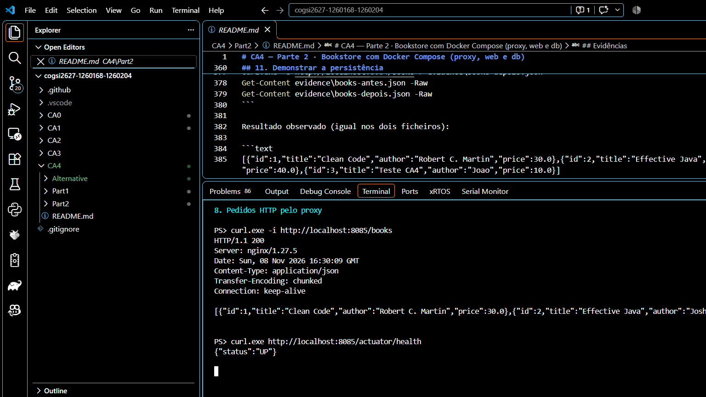
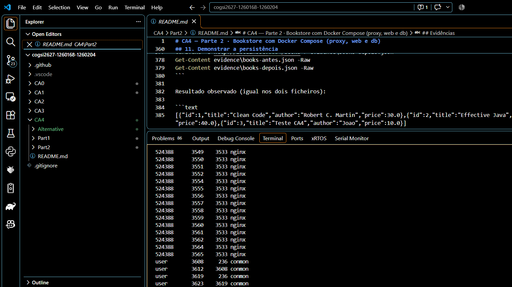
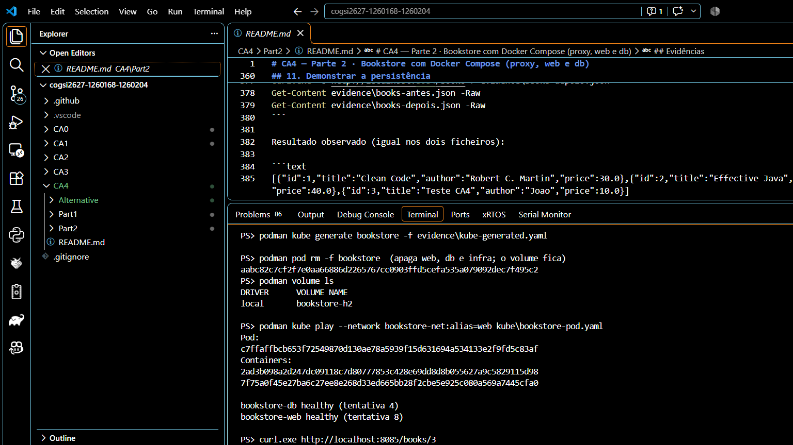
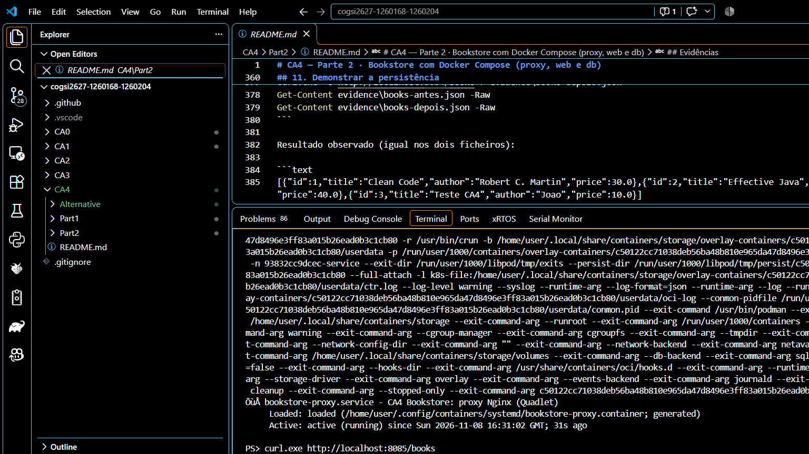
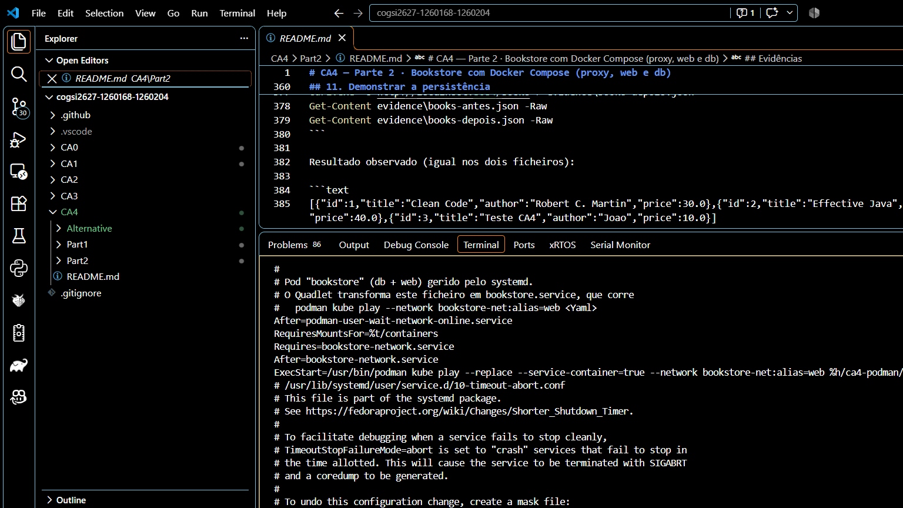

# CA4 — Alternativa · A Bookstore da Parte 2 com Podman

A Parte 2 pôs a Bookstore a correr em três containers (proxy, web e db) com Docker Compose. Esta alternativa corre a **mesma aplicação, com as mesmas imagens**, mas usando o modelo próprio do Podman: um **pod** para web e db, execução **rootless** e **sem daemon**, o formato **Kubernetes** (`kube generate` / `kube play`) e **Quadlet**, que entrega o ciclo de vida ao **systemd**. No fim, o `compose.yaml` da Parte 2 também é corrido com `podman compose`, para avaliar a compatibilidade.

Todos os resultados abaixo vêm de uma execução real, num portátil Windows com Podman 5.8, guardados na pasta `evidence`.

O enunciado e o docente pedem que a alternativa não se limite a trocar `docker` por `podman`, e que explore características próprias do Podman. A tabela mostra onde cada tópico sugerido é tratado:

| Tópico sugerido | Como foi explorado | Secção |
| --- | --- | --- |
| Funcionamento sem daemon central | Ausência de `dockerd`/`containerd`, um `conmon` por container, API ativada por socket | 4 e 9 |
| Execução sem root | Modo rootless, mapeamento de UIDs, utilizador do container vs. utilizador do host | 9 |
| Pods | Pod com web e db, container infra, namespaces partilhados, comparação com serviços do Compose | 6, 7 e 8 |
| Redes e comunicação | `localhost` dentro do pod, DNS da rede Podman entre pod e proxy, alias de rede | 6 e 8 |
| Volumes e persistência | Volume nomeado, pod apagado e recriado sem perder dados | 10 |
| systemd / Quadlet | Pod e proxy como serviços, dependências, reinício automático, journal | 11 |
| Suporte a Compose | `compose.yaml` da Parte 2 com `podman compose`: o que funciona, quem o executa, diferenças | 12 |

Os pontos que não ficaram totalmente cobertos estão explicados, um a um, na secção 14.

## 1. Desenho: o que muda em relação ao Docker Compose

```text
Windows / navegador
        |  http://localhost:8085
        v
bookstore-proxy  (Nginx, container fora do pod)
        |  http://web:8080  — "web" é o alias do pod na rede bookstore-net
        v
+-- pod "bookstore"  (partilha net, ipc e uts) -----------+
|  bookstore-web (Spring Boot)                            |
|        |  jdbc:h2:tcp://localhost:9092/./bookstore      |
|        v                                                |
|  bookstore-db (H2 TCP)                                  |
+-------------------------|-------------------------------+
                          v
                volume "bookstore-h2"
```

| Aspeto | Docker Compose (Parte 2) | Podman (esta alternativa) |
| --- | --- | --- |
| Motor | Daemon `dockerd` permanente, normalmente com privilégios de root | Sem daemon: cada container tem um processo `conmon` próprio; corre como utilizador normal (rootless) |
| Agrupamento | 3 serviços independentes, cada um com a sua pilha de rede | 1 **pod** (web + db) a partilhar a rede, e o proxy fora do pod |
| web → db | Pelo nome do serviço: `jdbc:h2:tcp://db:9092` | Por `localhost:9092`, porque estão no mesmo namespace de rede |
| proxy → web | Pelo nome do serviço `web` | Pelo alias de rede `web`, dado ao pod |
| Definição | `compose.yaml` | Comandos `podman`, depois um YAML Kubernetes (`kube/bookstore-pod.yaml`) |
| Ordem de arranque | `depends_on` + `condition: service_healthy` | Passo a passo: esperar que o db fique healthy antes de arrancar o web; com Quadlet, dependências do systemd |
| Recuperação de falhas | `restart: unless-stopped`, gerido pelo daemon | `restartPolicy: Always` (conmon) e `Restart=always` (systemd) |
| Arranque com o sistema | Depende do daemon arrancar | Unidades systemd geradas pelo Quadlet (`WantedBy=default.target`) |

Escolhi o pod para web e db porque é a característica mais distinta do Podman e porque estes dois serviços vivem juntos: a aplicação não funciona sem a sua base de dados. O proxy fica fora do pod de propósito: é o único ponto de entrada, e assim a demonstração mostra as duas formas de comunicação (dentro do pod por `localhost`, entre pod e container por nome numa rede Podman).

## 2. Ficheiros desta pasta

```text
CA4/Alternative/
├── podman-demo.ps1              # demonstração passo a passo (guarda saídas e prints)
├── kube/bookstore-pod.yaml      # o pod em formato Kubernetes, com probes
├── quadlet/bookstore.network    # rede bookstore-net como unidade systemd
├── quadlet/bookstore.kube       # o pod (via kube play) como serviço systemd
├── quadlet/bookstore-proxy.container  # o proxy como serviço systemd
└── evidence/                    # NN-passo.txt e NN-passo.png de cada passo
```

As imagens são construídas a partir dos Dockerfiles da Parte 2 (`../Part2/db`, `web` e `proxy`), sem alterações.

## 3. Preparar o Podman no Windows

```powershell
winget install RedHat.Podman
# reabrir o PowerShell (ou recarregar o PATH)
podman machine init
podman machine start
```

No Windows, o Podman precisa de uma máquina Linux (aqui em WSL). O `podman` do Windows é um **cliente** que fala com o Podman dentro dessa máquina. Com a máquina a correr, a demonstração completa é:

```powershell
cd CA4\Alternative
powershell -NoProfile -ExecutionPolicy Bypass -File .\podman-demo.ps1
```

O script espera por Enter antes de cada passo e grava `evidence/NN-nome.txt` e `evidence/NN-nome.png`. As secções seguintes seguem esses passos.

Nota: ao arrancar, a máquina Podman ficou a escutar no pipe `docker_engine`, o mesmo do Docker Desktop. O Podman expõe uma API compatível com a do Docker, por isso clientes Docker conseguem usá-lo. Durante a demonstração, o Docker Desktop esteve fechado para não disputar esse pipe.

## 4. Sem daemon e sem root (passo 1)

```text
Client:       Podman Engine   Version: 5.8.3   OS/Arch: windows/amd64
Server:       Podman Engine   Version: 5.8.9   OS/Arch: linux/amd64

NAME                     VM TYPE  ...  CPUS  MEMORY  DISK SIZE
podman-machine-default*  wsl           8     2GiB    100GiB

Rootless=true  Rede=netavark  OS=fedora

dockerd: nao existe
containerd: nao existe
active
```

- **Rootless=true**: a máquina está em modo rootless; os containers correm com o utilizador `user`, não com o root.
- **Sem `dockerd` nem `containerd`**: não há um processo central que seja dono de todos os containers.
- **`active`** é o `podman.socket`: o serviço da API é ativado por socket, ou seja, só arranca quando um cliente (o `podman` do Windows) faz um pedido. No Windows há um cliente e um servidor, mas o servidor não é um daemon permanente de que os containers dependam (secção 8).

## 5. Construir as imagens (passo 2)

```powershell
podman build -t localhost/bookstore-db:ca4    ..\Part2\db
podman build -t localhost/bookstore-web:ca4   ..\Part2\web
podman build -t localhost/bookstore-proxy:ca4 ..\Part2\proxy
```

```text
REPOSITORY                 TAG   IMAGE ID      SIZE
localhost/bookstore-proxy  ca4   cd828d21a3fe  49.7 MB
localhost/bookstore-web    ca4   3a17cdb56121  239 MB
localhost/bookstore-db     ca4   e8af4ec4cf77  190 MB
```

O Podman constrói com o Buildah e aceita os Dockerfiles e o `.dockerignore` da Parte 2 sem mudanças. As imagens ficam no armazenamento do utilizador (`~/.local/share/containers`), separado do Docker. O prefixo `localhost/` indica que são imagens locais, não de um registo.

## 6. Rede, volume e pod (passos 3 e 4)

```powershell
podman network create bookstore-net
podman volume create bookstore-h2
podman pod create --name bookstore --network bookstore-net --network-alias web
```

```text
POD ID        NAME       STATUS   INFRA ID      # OF CONTAINERS
aabc82c7cf2f  bookstore  Created  8d2c438cbfb2  1
```

Um pod acabado de criar já tem um container: o **infra** (`aabc82c7cf2f-infra`). É ele que mantém os namespaces partilhados (rede, IPC e hostname) mesmo quando os containers da aplicação param ou são recriados. O Docker Compose não tem este conceito: cada serviço tem a sua própria pilha de rede.

O `--network-alias web` regista o pod na rede `bookstore-net` com o nome `web`. Assim, o `nginx.conf` da Parte 2 (`proxy_pass http://web:8080`) funciona sem alterações.

## 7. Arrancar os containers por ordem (passos 5 a 7)

```powershell
podman run -d --pod bookstore --name bookstore-db -v bookstore-h2:/data `
    --health-cmd "java -cp /opt/h2.jar org.h2.tools.Shell -url jdbc:h2:tcp://localhost:9092/./bookstore -user sa -password '' -sql 'SELECT 1' | grep -q 1" `
    --health-interval 10s --health-timeout 5s --health-retries 6 --health-start-period 10s `
    localhost/bookstore-db:ca4
# esperar: podman healthcheck run bookstore-db

podman run -d --pod bookstore --name bookstore-web `
    -e SPRING_DATASOURCE_URL=jdbc:h2:tcp://localhost:9092/./bookstore `
    -e SPRING_DATASOURCE_USERNAME=sa -e SPRING_DATASOURCE_PASSWORD= -e SERVER_PORT=8080 `
    --health-cmd 'wget -qO- http://localhost:8080/actuator/health | grep -q UP' `
    --health-interval 10s --health-timeout 5s --health-retries 6 --health-start-period 30s `
    localhost/bookstore-web:ca4
# esperar: podman healthcheck run bookstore-web

podman run -d --name bookstore-proxy --network bookstore-net -p 8085:80 localhost/bookstore-proxy:ca4
```

```text
bookstore-db healthy (tentativa 1)
bookstore-web healthy (tentativa 3)

CONTAINER ID  IMAGE                          STATUS                   PORTS                 NAMES               PODNAME
8d2c438cbfb2                                 Up 14 seconds                                  aabc82c7cf2f-infra  bookstore
73017f220c3f  localhost/bookstore-db:ca4     Up 14 seconds (healthy)  9092/tcp              bookstore-db        bookstore
b8c769fc59b1  localhost/bookstore-web:ca4    Up 12 seconds (healthy)  8080/tcp              bookstore-web       bookstore
2f7a25c0691c  localhost/bookstore-proxy:ca4  Up 2 seconds             0.0.0.0:8085->80/tcp  bookstore-proxy
```

Diferença em relação ao Compose: o Podman não tem `depends_on`. A ordem `db healthy → web → web healthy → proxy` é garantida pelo script, que corre `podman healthcheck run` até o container ficar healthy antes de arrancar o seguinte. Com Quadlet (secção 11), esta ordem passa para as dependências do systemd.

Só o proxy publica uma porta (8085, para não colidir com a 8084 da Parte 2). Os portos 9092 e 8080 ficam apenas dentro do pod.

## 8. Testar e observar a comunicação (passos 8 e 9)



```text
HTTP/1.1 200
Server: nginx/1.27.5
[{"id":1,"title":"Clean Code",...},{"id":2,"title":"Effective Java",...}]

{"status":"UP"}
```

```text
Pod=bookstore  Partilhado=[ipc net uts]

PS> podman exec bookstore-web printenv SPRING_DATASOURCE_URL
jdbc:h2:tcp://localhost:9092/./bookstore

PS> podman exec bookstore-proxy getent hosts web
10.89.0.2         web.dns.podman  web.dns.podman web
```

- Dentro do pod, a aplicação liga-se ao H2 por **`localhost`**: web e db partilham o namespace `net`, como dois processos na mesma máquina.
- O proxy, fora do pod, chega ao pod pelo **DNS da rede Podman** (`aardvark-dns`): `web` resolve para o IP do pod (`10.89.0.2`).
- Os namespaces partilhados no pod são `ipc`, `net` e `uts`. Os sistemas de ficheiros e os processos continuam separados.

## 9. Rootless na prática (passo 10)



```text
PS> podman top bookstore-web user huser args
USER        HUSER       COMMAND
bookstore   524387      java -jar /app/app.jar

PS> podman top bookstore-db user huser args
USER        HUSER       COMMAND
h2          524387      java -cp /opt/h2.jar org.h2.tools.Server -tcp ...

PS> podman unshare cat /proc/self/uid_map
         0       1000          1
         1     524288      65536
```

O mapeamento de UIDs explica as colunas:

- O **root do container (UID 0)** corresponde ao utilizador `user` da máquina (UID 1000), que não tem privilégios de administrador.
- Os **restantes UIDs do container (1 a 65536)** correspondem a um intervalo reservado do host (524288 em diante). O utilizador `bookstore` (ou `h2`) do container é o UID 524387 no host, um UID sem conta e sem permissões fora do intervalo.

Nos processos da máquina:

```text
user        3126     236 conmon
524387      3128    3126 java      <- bookstore-db
user        3249     236 conmon
524387      3251    3249 java      <- bookstore-web
user        3531     236 conmon
user        3533    3531 nginx     <- master do Nginx (root do container = user)
524388      3548    3533 nginx     <- workers do Nginx (utilizador nginx do container)
```

Cada container tem um **`conmon`** próprio, que é o processo pai do container e guarda o seu estado e os seus logs. Não há um `dockerd` por cima de todos.

**Implicações de segurança.** Com Docker em modo normal, o daemon corre como root, e quem consegue falar com ele (ou escapar de um container) tem efetivamente root no host. Aqui há duas camadas: o `USER bookstore`/`USER h2` das imagens (definido na Parte 2) já impedia a aplicação de correr como root dentro do container; o rootless do Podman acrescenta que **mesmo o root do container é um utilizador sem privilégios no host**. Um atacante que escape do container fica com o UID 524387 (ou, no pior caso, com o utilizador `user`), não com root.

**Limitações do rootless.** Um utilizador sem privilégios não pode publicar portas abaixo de 1024 sem configuração extra (por isso o proxy usa 8085 → 80, sendo 80 só dentro do container), e o tráfego de rede passa por uma pilha em espaço de utilizador, um pouco mais lenta que a ponte de rede do Docker.

## 10. Formato Kubernetes e persistência (passo 11)



O Podman exporta um pod para YAML do Kubernetes e recria-o a partir desse YAML:

```powershell
# criar um livro no pod que está a correr
Invoke-RestMethod -Method Post -Uri http://localhost:8085/books -ContentType application/json `
    -Body (@{ title='Livro de teste Podman'; author='Joao'; price=12.5 } | ConvertTo-Json)

podman kube generate bookstore -f evidence\kube-generated.yaml
podman pod rm -f bookstore              # apaga web, db e infra
podman volume ls                        # o volume bookstore-h2 continua lá
podman kube play --network bookstore-net:alias=web kube\bookstore-pod.yaml
podman restart bookstore-proxy          # o Nginx resolve "web" ao arrancar
curl.exe http://localhost:8085/books/3
```

```text
Livro criado com id 3
...
bookstore-db healthy (tentativa 4)
bookstore-web healthy (tentativa 8)

{"id":3,"title":"Livro de teste Podman","author":"Joao","price":12.5,...}
```

O livro sobreviveu: o pod foi apagado e recriado, mas os dados estão no volume `bookstore-h2`, fora dos containers. O mesmo volume é reaproveitado pelo `kube play` porque o YAML o refere como `persistentVolumeClaim` com `claimName: bookstore-h2`.

**`kube generate` vs. o YAML guardado.** O ficheiro gerado (`evidence/kube-generated.yaml`) é um bom ponto de partida, mas **não inclui os healthchecks** nem a variável de palavra-passe vazia, e tem anotações específicas desta máquina. Por isso o `kube/bookstore-pod.yaml` do repositório foi limpo à mão, com:

- `livenessProbe` com os mesmos comandos dos healthchecks (o `kube play` converte-as em healthchecks do Podman);
- `restartPolicy: Always`;
- as variáveis de ambiente necessárias, sem valores da máquina.

O `--network bookstore-net:alias=web` volta a dar ao pod o alias `web`: o YAML descreve o pod, mas não a rede onde ele é ligado.

Este YAML é o mesmo formato que um cluster Kubernetes aceita (com um PersistentVolumeClaim real), o que o Docker Compose não oferece diretamente.

## 11. Quadlet: o pod e o proxy como serviços systemd (passos 12 e 13)

O Quadlet lê ficheiros declarativos em `~/.config/containers/systemd/` e gera unidades systemd a partir deles. Três ficheiros chegam:

```ini
# quadlet/bookstore.network
[Network]
NetworkName=bookstore-net
```

```ini
# quadlet/bookstore.kube
[Unit]
Description=CA4 Bookstore: pod com H2 e Spring Boot (Quadlet)

[Kube]
Yaml=%h/ca4-podman/bookstore-pod.yaml
Network=bookstore.network:alias=web

[Install]
WantedBy=default.target
```

```ini
# quadlet/bookstore-proxy.container
[Unit]
Description=CA4 Bookstore: proxy Nginx (Quadlet)
Requires=bookstore.service
After=bookstore.service

[Container]
Image=localhost/bookstore-proxy:ca4
ContainerName=bookstore-proxy
Network=bookstore.network
PublishPort=8085:80

[Service]
Restart=always
RestartSec=3

[Install]
WantedBy=default.target
```

Instalação e arranque, dentro da máquina Podman:

```bash
mkdir -p ~/.config/containers/systemd ~/ca4-podman
cp quadlet/* ~/.config/containers/systemd/
cp kube/bookstore-pod.yaml ~/ca4-podman/
systemctl --user daemon-reload
systemctl --user start bookstore-proxy.service   # arrasta bookstore.service e a rede
```



```text
● bookstore.service - CA4 Bookstore: pod com H2 e Spring Boot (Quadlet)
     Loaded: loaded (/home/user/.config/containers/systemd/bookstore.kube; generated)
     Active: active (running) since Sun 2026-11-08 16:31:02 GMT
● bookstore-proxy.service - CA4 Bookstore: proxy Nginx (Quadlet)
     Loaded: loaded (/home/user/.config/containers/systemd/bookstore-proxy.container; generated)
     Active: active (running) since Sun 2026-11-08 16:31:02 GMT

[{"id":1,...},{"id":2,...},{"id":3,"title":"Livro de teste Podman","author":"Joao","price":12.5}]
```

O `bookstore.service` foi gerado pelo Quadlet e corre o mesmo `kube play` da secção 10:

```text
# Automatically generated by /usr/lib/systemd/user-generators/podman-user-generator
Requires=bookstore-network.service
After=bookstore-network.service
ExecStart=/usr/bin/podman kube play --replace --service-container=true --network bookstore-net:alias=web %h/ca4-podman/bookstore-pod.yaml
```

O livro 3 continua presente: os serviços reutilizaram o volume `bookstore-h2`.

**Recuperação de falhas.** O script matou o proxy, e o systemd recriou-o:



```text
PS> podman kill bookstore-proxy
PS> podman ps
93832cc9dcec-service  Up 42 seconds
6f01e1229014-infra    Up 42 seconds
bookstore-db          Up 42 seconds (healthy)
bookstore-web         Up 42 seconds (healthy)
bookstore-proxy       Up 4 seconds
```

O `93832cc9dcec-service` é o container de serviço que o `kube play --service-container` cria para o systemd acompanhar o pod como uma única unidade. Os logs ficam no journal: `journalctl --user -u bookstore-proxy.service`.

**Quadlet vs. Compose.** No Compose, o ciclo de vida é do daemon do Docker (`restart: unless-stopped`) e da ordem do `depends_on`. Com Quadlet, é do systemd: dependências (`Requires`, `After`), reinício (`Restart=always`), arranque com o sistema (`WantedBy=default.target`) e logs no journal, com as mesmas ferramentas usadas para qualquer outro serviço Linux (como no CA2 e no CA3).

## 12. Suporte a ficheiros Compose (passo 14)

O mesmo `compose.yaml` da Parte 2, sem alterações:

```powershell
$env:PROXY_PORT = '8086'
podman compose -f ..\Part2\compose.yaml -p bookstore-podcompose up -d
```


```text
>>>> Executing external compose provider "...\DockerDesktop\resources\bin\docker-compose.exe" <<<<
 Container bookstore-podcompose-db-1 Healthy
 Container bookstore-podcompose-web-1 Healthy
 Container bookstore-podcompose-proxy-1 Started

bookstore-podcompose-db-1     Up 18 seconds (healthy)  9092/tcp
bookstore-podcompose-web-1    Up 17 seconds (healthy)  8080/tcp
bookstore-podcompose-proxy-1  Up 5 seconds             0.0.0.0:8086->80/tcp

[{"id":1,"title":"Clean Code",...},{"id":2,"title":"Effective Java",...}]
```

| Ponto | Observação |
| --- | --- |
| Quem interpreta o ficheiro | O `podman compose` **não tem implementação própria**: delega num fornecedor externo. Aqui usou o `docker-compose.exe` (v5.6.1) instalado pelo Docker Desktop, que falou com a API do Podman. Sem esse fornecedor (ou o `podman-compose` em Python), o comando não funciona. |
| Funcionou sem alterações | Build, redes com IPs fixos, volume nomeado, healthchecks, `depends_on` com `service_healthy`, publicação de portas e variáveis do `.env`. |
| Diferença de modelo | O Compose criou **três containers soltos**, não um pod: não usa nenhuma das características próprias do Podman. Por isso esta alternativa não se fica pelo `podman compose`. |
| Dependência | Funciona porque o Podman expõe uma API compatível com a do Docker. Como os dois disputam o pipe `docker_engine` no Windows, convém não ter os dois motores ativos ao mesmo tempo. |

## 13. Análise comparativa

| Critério | Docker + Compose | Podman |
| --- | --- | --- |
| Arquitetura | Cliente → daemon `dockerd` (root) → containerd → containers | Cliente → Podman → `conmon` por container; no Windows, através de uma máquina Linux com a API ativada por socket |
| Privilégios | Daemon como root; rootless possível, mas não é o modo por omissão | Rootless por omissão; root do container mapeado para um utilizador comum |
| Agrupamento | Serviços independentes numa rede | Pods com namespaces partilhados (como no Kubernetes) |
| Descoberta de serviços | DNS interno da rede do Compose | DNS da rede Podman (aardvark-dns) entre pods/containers; `localhost` dentro do pod |
| Ordem de arranque | `depends_on` + `condition: service_healthy` | Manual (script) com `podman run`; `Requires`/`After` com Quadlet |
| Volumes | Volumes nomeados | Volumes nomeados; no YAML Kubernetes, `persistentVolumeClaim` |
| Formato declarativo | `compose.yaml` | YAML Kubernetes (`kube play`) e unidades Quadlet; Compose só via fornecedor externo |
| Ciclo de vida | Daemon (`restart:`) | systemd (`Restart=`, `WantedBy=`, journal) |
| No Windows | Docker Desktop (WSL 2) | Podman machine (WSL 2), mesma ideia de VM Linux |

**O que o Podman trouxe de diferente nesta solução:**

1. **Menos superfície de ataque**: nenhum processo root central, e os UIDs do container não correspondem a utilizadores reais do host.
2. **Pod como unidade**: web e db são geridos juntos (`podman pod rm` apaga os dois) e falam por `localhost`, como numa VM do CA2.
3. **Ponte para o Kubernetes**: o mesmo pod passou a YAML do Kubernetes e foi recriado a partir dele.
4. **Integração com systemd**: o Quadlet tornou o pod e o proxy serviços normais do Linux, com reinício automático e logs no journal.

**O que o Docker Compose faz melhor:**

1. **Ordem por healthcheck num só ficheiro**: o `service_healthy` resolve a ordem sem script; no Podman puro foi preciso esperar explicitamente.
2. **Tudo num ficheiro**: rede, volume, serviços e dependências estão no `compose.yaml`; aqui estão divididos entre o YAML do pod, as opções de rede e os ficheiros Quadlet.
3. **Ferramentas e documentação**: o ecossistema Compose é mais usado; o `podman compose` depende de um fornecedor externo.

## 14. Requisitos não cobertos e limitações

Esta secção explica cada ponto que a solução com Podman não cobre por completo: o que falta, porque acontece e como se resolveria.

### 14.1 A ordem de arranque com Quadlet não espera pelo healthcheck

**O que falta.** No Compose, o proxy só arranca quando o web está *healthy* (`condition: service_healthy`). Com Quadlet, o `bookstore-proxy.service` arranca quando o `bookstore.service` fica *ativo*, ou seja, quando os containers do pod arrancaram, e não quando a aplicação responde.

**Porquê.** O systemd não conhece healthchecks: só sabe se um serviço arrancou ou falhou. A ponte entre os dois é a opção `Notify=healthy`, que faz o Podman avisar o systemd apenas quando o container fica healthy. Essa opção existe para unidades `.container`. O pod desta solução é uma unidade `.kube` (o `kube play` do YAML da secção 10), e para `.kube` o Podman avisa o systemd quando os containers arrancam. Escolhi `.kube` para reutilizar o mesmo YAML Kubernetes nas secções 10 e 11, em vez de descrever o pod duas vezes.

**Impacto.** Pequeno nesta aplicação. O Nginx só precisa que o nome `web` exista para arrancar, e o alias é registado quando o pod é criado. Se o proxy receber pedidos antes de a Bookstore estar pronta, responde `502` durante alguns segundos. A base de dados é o primeiro container do pod e o H2 arranca em cerca de um segundo, muito antes de o Spring precisar dela; se a ligação falhasse, o `restartPolicy: Always` voltava a arrancar o web.

**Como se resolveria.** Descrever o pod com unidades `.pod` e `.container` (Podman 5), em vez de `.kube`: `bookstore.pod`, `bookstore-db.container` e `bookstore-web.container` com `Notify=healthy`, e `After=`/`Requires=` entre eles. Assim o systemd reproduz a ordem `db healthy → web healthy → proxy`. Não o fiz para manter um só ficheiro de descrição do pod.

### 14.2 O Podman, sem Quadlet, não tem `depends_on`

**O que falta.** Com comandos `podman run` (secção 7), não há uma forma declarativa de dizer "o web depende do db".

**Porquê.** O Podman não tem daemon, e por isso não tem um processo que acompanhe o estado de todos os containers para decidir quando arrancar o seguinte. No Docker Compose, é o próprio `docker compose` que espera pelos healthchecks antes de criar o próximo container. No Podman, essa responsabilidade passa para quem orquestra: um script, o systemd (Quadlet) ou um cluster Kubernetes.

**Como foi resolvido aqui.** O script espera com `podman healthcheck run` até cada container ficar healthy (`bookstore-db healthy (tentativa 1)`, `bookstore-web healthy (tentativa 3)`) antes de arrancar o seguinte.

### 14.3 O Nginx não acompanha a mudança de IP do pod

**O que falta.** Na secção 10, depois de apagar e recriar o pod, foi preciso `podman restart bookstore-proxy`.

**Porquê.** O Nginx resolve o nome do `proxy_pass` (`web`) uma vez, ao arrancar, e guarda o IP. O pod recriado recebe um IP novo na rede `bookstore-net`, e o Nginx continuaria a enviar pedidos para o IP antigo. O mesmo aconteceria com Docker Compose se o container `web` fosse recriado sem recriar o proxy.

**Como foi resolvido.** Reiniciando o proxy. Com Quadlet, o `Requires=bookstore.service` faz o systemd reiniciar o proxy sempre que o pod é reiniciado. Uma alternativa seria configurar o Nginx com `resolver` e uma variável no `proxy_pass`, para voltar a resolver o nome; não o fiz para não alterar a imagem do proxy da Parte 2.

### 14.4 O `kube generate` não exporta os healthchecks

**O que falta.** O `evidence/kube-generated.yaml` não tem os healthchecks dos containers, nem a variável `SPRING_DATASOURCE_PASSWORD` vazia.

**Porquê.** O Kubernetes não tem o conceito de healthcheck do Docker/Podman: usa *probes* (`livenessProbe`, `readinessProbe`), com outra semântica. O `kube generate` não converte os healthchecks em probes. As variáveis com valor vazio também não são exportadas.

**Como foi resolvido.** O `kube/bookstore-pod.yaml` foi completado à mão com `livenessProbe` que repetem os mesmos comandos. No sentido inverso, o `kube play` converte as `livenessProbe` em healthchecks do Podman, e por isso os containers recriados voltaram a aparecer como healthy. A `readinessProbe` não foi usada: no Podman não tem o mesmo efeito que num cluster (não há um Service a tirar o pod do balanceamento).

### 14.5 No Windows, o Podman não é totalmente "sem servidor"

**O que acontece.** O `podman version` mostra um *Client* (Windows) e um *Server* (Linux, na máquina WSL). O cliente do Windows fala com a API do Podman dentro da máquina.

**Porquê.** Containers Linux precisam de um kernel Linux. No Windows, tanto o Docker Desktop como o Podman usam uma máquina Linux em WSL 2. A diferença está dentro dessa máquina: o serviço da API do Podman é ativado por socket (`podman.socket` estava `active`) e só serve pedidos. Os containers não são filhos dele: cada um tem o seu `conmon`, e continuam a correr se o serviço da API parar. No Docker, os containers dependem do `dockerd` (e do `containerd`), e uma falha do daemon afeta todos.

**Consequência para a demonstração.** A característica "sem daemon" observa-se dentro da máquina (secção 9), não no Windows.

### 14.6 O `podman compose` depende de um fornecedor externo

**O que acontece.** O passo 14 funcionou, mas a saída mostra que quem interpretou o `compose.yaml` foi o `docker-compose.exe` instalado pelo Docker Desktop.

**Porquê.** O Podman não implementa a especificação Compose. O `podman compose` é um invólucro que procura um fornecedor (`docker-compose` ou o `podman-compose` em Python) e aponta-o para a API compatível do Podman. Sem um fornecedor instalado, o comando falha. Além disso, o Compose cria containers independentes, sem pods, e não usa o Quadlet: com `podman compose`, perdem-se as características próprias do Podman.

**Porque não é a solução principal.** Por esse motivo, a alternativa usa pods, `kube play` e Quadlet, e o Compose aparece só como avaliação de compatibilidade.

### 14.7 As imagens não foram publicadas no Docker Hub com o Podman

**O que falta.** A publicação das imagens desta alternativa num registo.

**Porquê.** As imagens são exatamente as da Parte 2 (os mesmos Dockerfiles), e a publicação do grupo é feita a partir do Docker. As imagens produzidas pelo Podman seguem o mesmo formato OCI, por isso publicá-las de novo daria imagens equivalentes com outro digest, sem acrescentar nada à comparação.

**Como se faria.** `podman login docker.io`, `podman tag localhost/bookstore-web:ca4 docker.io/<conta>/ca4-bookstore-web:podman` e `podman push docker.io/<conta>/ca4-bookstore-web:podman`, igual para db e proxy.

### 14.8 Portas abaixo de 1024 em modo rootless

**O que acontece.** O proxy publica a porta 8085 no host, e só usa a 80 dentro do container.

**Porquê.** Por omissão, o Linux só deixa o root abrir portas abaixo de 1024. Em modo rootless, o Podman corre como utilizador normal, por isso não pode publicar a 80 do host sem configuração extra (`sysctl net.ipv4.ip_unprivileged_port_start=80` na máquina, ou `podman machine set --rootful`). Mudar para rootful anularia a vantagem de segurança da secção 9, por isso usei uma porta alta.

### 14.9 Arranque e dados ficam presos à máquina Podman

**O que acontece.** Os serviços Quadlet arrancam quando a máquina Podman arranca (`podman machine start`), e não quando o Windows arranca. O volume `bookstore-h2` está no disco virtual da máquina.

**Porquê.** O systemd que gere as unidades Quadlet é o da máquina Linux, não um serviço do Windows. Os volumes vivem no armazenamento do utilizador dentro dessa máquina. Um `podman machine rm` apaga a máquina e, com ela, os dados. Num servidor Linux (o caso para o qual o Quadlet foi feito), as unidades com `WantedBy=default.target` arrancam com o sistema, e com `loginctl enable-linger` mesmo sem sessão aberta.

## 15. Parar e limpar

```powershell
podman machine ssh 'systemctl --user stop bookstore-proxy.service bookstore.service'
podman pod rm -f bookstore
podman rm -f bookstore-proxy
podman volume rm bookstore-h2      # apaga a base de dados
podman machine stop
```

## Evidências

| Passo | Ficheiros |
| --- | --- |
| 1. Sem daemon e rootless | `evidence/01-sem-daemon-rootless.txt` / `.png` |
| 2. Build das imagens | `evidence/02-build.txt` / `.png` |
| 3. Rede e volume | `evidence/03-rede-volume.txt` / `.png` |
| 4. Pod | `evidence/04-pod.txt` / `.png` |
| 5–7. db, web e proxy | `evidence/05-db`, `06-web`, `07-proxy` (`.txt` / `.png`) |
| 8. HTTP | `evidence/08-http.txt` / `.png` |
| 9. Rede do pod | `evidence/09-rede-pod.txt` / `.png` |
| 10. Rootless | `evidence/10-rootless.txt` / `.png` |
| 11. Kube e persistência | `evidence/11-kube-persistencia.txt` / `.png`, `evidence/kube-generated.yaml` |
| 12–13. Quadlet | `evidence/12-quadlet`, `13-quadlet-restart` (`.txt` / `.png`) |
| 14. Compose | `evidence/14-compose.txt` / `.png` |

Referências: [podman-pod-create](https://docs.podman.io/en/latest/markdown/podman-pod-create.1.html) · [podman-kube-play](https://docs.podman.io/en/latest/markdown/podman-kube-play.1.html) · [Quadlet (podman-systemd.unit)](https://docs.podman.io/en/latest/markdown/podman-systemd.unit.5.html) · [podman-compose](https://docs.podman.io/en/latest/markdown/podman-compose.1.html) · [Rootless Podman](https://github.com/containers/podman/blob/main/docs/tutorials/rootless_tutorial.md)
