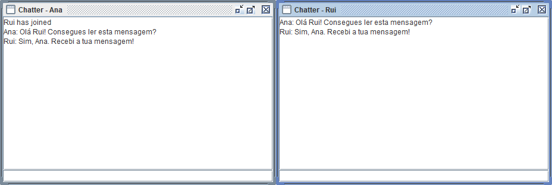

# CA4 — Parte 1 · Executar o Chat e a Bookstore com Docker

Neste tutorial vais pôr dois servidores Java do CA1 a correr em containers Linux. No Windows, vais abrir duas janelas de Chat e trocar mensagens entre elas. Depois vais usar o PowerShell como cliente da Bookstore para criar um livro e voltar a consultá-lo pelo identificador atribuído pela aplicação.

Para cada servidor vais construir três imagens. Todas devem oferecer a mesma funcionalidade. A experiência consiste em mudar o local onde o Gradle compila a aplicação e observar o efeito dessa escolha no tamanho da imagem, no tempo de construção e nas ferramentas disponíveis durante a execução.

## 1. Preparar o terminal

Abre o Docker Desktop em modo de containers Linux e um terminal PowerShell 7 na raiz do repositório, a pasta que contém `CA1` e `CA4`. Usa essa pasta como ponto de partida para todos os blocos de comandos, incluindo os que executares num segundo terminal.

```powershell
git branch --show-current
$PSVersionTable.PSVersion
docker version
docker info --format '{{.OSType}}'
java -version
javac -version
python --version
```

Confirma que estás na branch `ca4-part1`. Em `docker version` devem aparecer as secções `Client` e `Server`, e o tipo de sistema deve ser `linux`. Se aparecer apenas o cliente seguido de um erro de ligação, espera que o motor do Docker Desktop termine o arranque e repete o comando.

Usa um JDK 17 para a compilação local e Python 3 para os testes de comunicação. Se tiveres `JAVA_HOME` definido, confirma que aponta para a pasta do JDK 17. Cada aplicação inclui o seu Gradle Wrapper (`gradlew.bat` no Windows e `gradlew` no Linux). Na primeira construção, o Wrapper descarrega a distribuição de Gradle indicada pelo projeto. Também precisas de rede para obter as imagens base, o pacote Git usado na v1 e as dependências Java.

## 2. Identificar o que vai para cada imagem

O **host** é o Windows onde vais correr os clientes. Uma **imagem** contém o sistema de ficheiros e a configuração de arranque da aplicação. Quando executas `docker run`, o Docker cria um **container** a partir dessa imagem e inicia o processo do servidor.

| Aplicação | Pasta de construção dentro de `CA4/Part1` | O que o Gradle produz | Porta interna |
| --- | --- | --- | --- |
| Chat | `source/CA1/week1/build_tools/gradle_demo` | Um JAR com as classes do Chat e uma pasta `lib` com as dependências | 59001/TCP |
| Bookstore | `source/CA1/week2` | Um JAR executável Spring Boot com a aplicação e as dependências | 8080/HTTP |

Abre os três Dockerfiles de uma aplicação e segue o percurso do código até ao processo Java.

1. **v1 — clonar e compilar numa única imagem.** O script exporta do commit atual os fontes da aplicação, os ficheiros Gradle e o Wrapper. Cria um repositório Git independente com esses ficheiros, grava um único commit e gera o `source.bundle` a partir desse commit. Dentro da imagem `17-jdk`, o Dockerfile instala Git, copia o bundle, clona a branch a partir desse ficheiro e executa o Gradle. O clone funciona sem fornecer credenciais do GitHub ao Docker. O servidor arranca nessa mesma imagem, que conserva o bundle, o clone, o compilador e a cache da compilação. O histórico do grupo fica fora deste repositório de compilação.
2. **v2 — compilar no Windows e copiar o resultado.** O Wrapper executa os testes e produz os JARs no host. O Dockerfile parte da imagem `17-jre`, que fornece o ambiente de execução Java, e copia os ficheiros já preparados. No Chat, a instrução `COPY` inclui a pasta `lib` porque o servidor carrega essas bibliotecas através de `java -cp`. Na Bookstore, basta copiar `app-1.0.0.jar` e iniciá-lo com `java -jar`.
3. **v3 — compilar e executar em estágios separados.** O primeiro `FROM` cria um estágio chamado `build` com o JDK. Aí, o Gradle transforma os fontes em JARs. O segundo `FROM` começa com o JRE e usa `COPY --from=build` para ir buscar os artefactos. O Dockerfile cria ainda o utilizador de sistema `app` e define `USER app` antes do arranque do servidor. Podes verificar esse utilizador no passo 7.

As três versões usam o projeto Gradle em `CA4/Part1/source/CA1`. A v1 lê o último commit da branch, enquanto a v2 e a v3 leem os ficheiros na pasta de trabalho. Faz commit das alterações à aplicação antes de construir para comparar as mesmas fontes.

## 3. Construir as seis imagens

Na raiz do repositório, executa o script de construção e espera que termine antes de avançar.

```powershell
./CA4/Part1/Build-Images.ps1 -NoCache
```

O script começa pelo Chat. Cria o bundle isolado do Chat, executa `:app:clean` para limpar o resultado anterior, corre `:app:test` e empacota a aplicação com `:app:packageApp`. Em seguida constrói as imagens com as tags `ca4-chat:v1`, `ca4-chat:v2` e `ca4-chat:v3`. Repete o processo para a Bookstore, usando `:app:bootJar` para produzir o JAR executável. A opção `-NoCache` passa `--no-cache` às construções Docker. As imagens base e os downloads guardados pelo Gradle no host podem já estar disponíveis.

No fim deves ver seis linhas com a tag, os tempos, o tamanho em bytes e o número de camadas. Para confirmar que podes usar as imagens localmente, lista os dois repositórios de imagens.

```powershell
docker image ls ca4-chat
docker image ls ca4-bookstore
```

**Para repetir uma construção individual**, entra na pasta da aplicação. Por exemplo, depois de o script ter preparado o bundle e os JARs do Chat, podes executar estas três construções independentemente.

```powershell
Push-Location ./CA4/Part1/source/CA1/week1/build_tools/gradle_demo
docker build -f Dockerfile.v1 --build-arg SOURCE_REF=ca4-part1 -t ca4-chat:v1 .
docker build -f Dockerfile.v2 -t ca4-chat:v2 .
docker build -f Dockerfile.v3 -t ca4-chat:v3 .
Pop-Location
```

O ponto final entrega a pasta atual ao Docker como **contexto de construção**. A opção `-f` seleciona o Dockerfile e `-t` atribui a tag pela qual vais escolher a imagem ao arrancar o servidor. Para a Bookstore, usa `./CA4/Part1/source/CA1/week2` e troca `ca4-chat` por `ca4-bookstore` nas tags.

Cada Dockerfile tem um ficheiro `.dockerignore` próprio. Na v1, o contexto admite o bundle que o Git vai clonar. Na v2, admite os JARs preparados no Windows. Se a instrução `COPY` da v2 falhar por faltar um ficheiro, confirma que o empacotamento local terminou com sucesso. Na v3, os diretórios `build` e `.gradle`, o histórico Git e o bundle ficam de fora, pelo que o estágio de compilação tem de gerar os seus próprios artefactos. Na Bookstore, esse contexto exclui também `maven-alternative`.

## 4. Arrancar os servidores e publicar as portas

Usa a v3 das duas aplicações para a demonstração. Mantém os containers em execução até terminares o passo 7.

```powershell
docker run -d --name ca4-chat-demo -p 127.0.0.1:59003:59001 ca4-chat:v3
docker run -d --name ca4-bookstore-demo -p 127.0.0.1:8083:8080 ca4-bookstore:v3
docker ps
```

A opção `-d` deixa o servidor em segundo plano e devolve o terminal. O nome dado em `--name` permite consultar os logs ou parar o container mais tarde. Lê `127.0.0.1:8083:8080` da esquerda para a direita. O cliente liga-se ao endereço local na porta **8083** do Windows. O Docker encaminha o pedido para a porta **8080** da Bookstore dentro do container. No Chat, o mesmo percurso liga **59003** a **59001**. A instrução `EXPOSE` no Dockerfile documenta a porta interna e a opção `-p` cria este encaminhamento.

Confirma os nomes e as portas na saída de `docker ps`. Se um servidor desaparecer da lista, usa `docker ps -a` para ver o estado e `docker logs ca4-bookstore-demo` ou `docker logs ca4-chat-demo` para ler o motivo. Se a porta do Windows estiver ocupada, escolhe outra porta livre no campo do meio e usa essa mesma porta nos comandos do cliente.

## 5. Trocar mensagens entre dois clientes de Chat

Abre **dois terminais** PowerShell na raiz do repositório. Executa este bloco em cada um e deixa ambos abertos. Cada execução inicia um cliente gráfico Swing no Windows.

```powershell
Set-Location ./CA4/Part1/source/CA1/week1/build_tools/gradle_demo
./gradlew.bat :app:runClient -PserverIP=localhost -PserverPort=59003
```

1. Na primeira janela, escolhe o nome `Ana`. Quando o servidor o aceitar, o título muda para `Chatter - Ana` e o campo de escrita fica ativo.
2. Na segunda janela, escolhe `Rui`. A primeira janela deve anunciar a entrada de Rui.
3. Na janela da Ana, escreve `Olá Rui` e carrega em Enter. Confirma que a mensagem aparece com o nome da Ana nas duas janelas.
4. Responde a partir da janela do Rui. Se a resposta chegar à Ana, confirmaste o percurso completo nos dois sentidos, desde o cliente no Windows até ao servidor no container e de volta ao outro cliente.

As duas janelas abaixo pertencem a clientes Swing ligados ao mesmo servidor v3. Em ambas podes ler a pergunta da Ana e a resposta do Rui.



## 6. Criar e consultar um livro pela API

Num terminal na raiz do repositório, guarda o endereço do servidor e consulta o estado da aplicação.

```powershell
$api = 'http://127.0.0.1:8083'
(Invoke-RestMethod "$api/actuator/health").status
```

Espera pela resposta `UP`. O Spring Boot pode ainda estar a inicializar quando o container aparece pela primeira vez em `docker ps`. Se a ligação falhar nesse momento, acompanha o arranque com `docker logs ca4-bookstore-demo` e repete o pedido.

Consulta agora o catálogo. Num arranque novo, a aplicação cria os livros *Clean Code* e *Effective Java*.

```powershell
$catalogo = Invoke-RestMethod "$api/books"
$catalogo | Format-Table id, title, author, price
```

No mesmo terminal, envia um novo livro em JSON. Guarda a resposta ao `POST` para poder usar o identificador que a base de dados lhe atribuiu.

```powershell
$dados = @{ title = 'Teste CA4'; author = 'Grupo COGSI'; price = 12.5 } | ConvertTo-Json
$livro = Invoke-RestMethod -Method Post -Uri "$api/books" -ContentType 'application/json' -Body $dados
Invoke-RestMethod "$api/books/$($livro.id)" | Select-Object id, title, author, price
```

O último pedido deve devolver o título `Teste CA4` e o mesmo identificador recebido na criação. Isto permite verificar a escrita e a leitura através da API. A Bookstore usa H2 em memória, pelo que o livro de teste existe enquanto o processo Java estiver ativo. Num novo arranque, a aplicação volta a carregar os dados de exemplo.

Na execução da v3, a aplicação atribuiu o identificador 3 ao livro. Estes são os campos recolhidos nas três respostas. [Saída da sessão PowerShell](evidence/bookstore-v3-api.txt)

~~~text
GET /actuator/health
{"status":"UP"}
POST /books
{"id":3,"title":"Teste CA4","author":"Grupo COGSI","price":12.5}
GET /books/3
{"id":3,"title":"Teste CA4","author":"Grupo COGSI","price":12.5}
~~~

## 7. Observar os containers durante a utilização

Com os servidores ativos, executa o comando seguinte num terminal e troca mensagens ou consulta a API noutro.

```powershell
docker stats ca4-chat-demo ca4-bookstore-demo
```

Observa `CPU %` e `MEM USAGE / LIMIT`. Na coluna de memória, o primeiro valor é o consumo observado e o segundo é o limite disponível. `NET I/O` mostra o tráfego recebido e enviado. Carrega em **Ctrl+C** para terminar a visualização. Os servidores continuam disponíveis. Para obter uma única amostra e consultar a identidade do processo, executa:

```powershell
docker stats --no-stream ca4-chat-demo ca4-bookstore-demo
docker exec ca4-chat-demo id
docker exec ca4-bookstore-demo id
```

O comando `id` corre dentro de cada container com o utilizador configurado na imagem. Nas imagens v3 deves ver `app` com um UID diferente de zero. Na execução registada foi `999`. Assim, o processo do servidor tem permissões de um utilizador de sistema comum. A verificação automática compara também a presença de Git e de `javac`, ferramentas que foram usadas para construir as imagens.

## 8. Verificar as seis versões e interpretar as medições

A demonstração manual usa a v3. Para testar as três versões de cada servidor, volta ao terminal da raiz e executa os comandos seguintes por ordem. Se reconstruíste imagens individualmente, volta a executar o script do passo 3 antes desta verificação para atualizar os identificadores em `images.json`.

```powershell
python ./CA4/Part1/Verify-Images.py
./CA4/Part1/Summarize-Results.ps1
```

O primeiro script cria um container temporário por imagem e pede ao Docker uma porta local disponível. No Chat, abre duas ligações TCP, responde ao pedido `SUBMITNAME` e espera pela confirmação `NAMEACCEPTED`. Envia depois uma mensagem de cada cliente e verifica o texto recebido em ambas as ligações. Na Bookstore, espera por `UP`, lista os livros, cria um registo e lê-o pelo identificador. Para cada imagem recolhe também o UID, procura Git e o compilador, guarda uma amostra de recursos e remove o container temporário.

Procura **seis linhas com `PASS`**, uma por tag. O segundo script cruza o identificador de cada imagem construída com o da imagem testada antes de gerar a tabela. Os scripts atualizam os ficheiros em `evidence/` a cada execução. Podes consultar a execução já registada no repositório.

| Para responder a esta pergunta | Consulta |
| --- | --- |
| Que versões passaram e quanto mediram? | [Resumo das seis imagens](evidence/RESULTS.md) |
| Que imagem foi construída, a partir de que commit e em quanto tempo? | [Medições da construção](evidence/images.json) |
| Que testes passaram e que recursos foram observados? | [Verificações por imagem](evidence/verification.json) |
| O que aconteceu numa etapa específica? | Na [pasta de evidências](evidence/), abre o ficheiro da aplicação terminado em `-host-build.txt`, `-build.txt`, `-history.txt` ou `-runtime.txt`. |

**Como ler o tamanho.** Na execução registada, o Chat ocupou 1044,19 MiB na v1, 411,82 MiB na v2 e 411,86 MiB na v3. A redução da v1 para a v2 acompanha a passagem do JDK com o clone Git e a cache Gradle para um JRE com os JARs. A v3 também compila dentro do Docker, mas só copia os artefactos para a imagem final. O tamanho indicado vem de `docker image inspect` e inclui as camadas da imagem. Camadas partilhadas por várias imagens podem ocupar espaço em disco uma única vez.

**Como ler o tempo.** Na Bookstore v2, a construção Docker demorou 6,66 s. Antes disso, o Windows gastou 29,45 s a compilar, testar e empacotar, dando um total de 36,11 s. Na v3, os 41,99 s de construção já incluem a compilação no primeiro estágio. Ao interpretar a diferença, considera que v1 e v3 executam a tarefa de empacotamento, enquanto a medição do host inclui também os testes. Foi feita uma medição por imagem. Downloads e caches locais podem alterar os tempos quando repetires o exercício.

**Como inspecionar as camadas.** Compara os históricos das três imagens do Chat. Podes repetir a experiência substituindo `ca4-chat` por `ca4-bookstore`.

```powershell
docker history --no-trunc ca4-chat:v1
docker history --no-trunc ca4-chat:v2
docker history --no-trunc ca4-chat:v3
```

Na v1, procura a instalação de Git, o clone e a execução do Wrapper. Na v2, identifica a cópia dos JARs por cima da base JRE. Na v3, procura a cópia a partir do estágio de compilação e a criação do utilizador. O histórico da imagem final segue o segundo `FROM`. Algumas linhas, como `EXPOSE` e `ENTRYPOINT`, só configuram metadados. Para contar camadas de ficheiros, o script usa `RootFS.Layers`.

## 9. Terminar a demonstração

Fecha as duas janelas do Chat. No terminal principal, para e remove os containers que criaste no passo 4.

```powershell
docker stop ca4-chat-demo ca4-bookstore-demo
docker rm ca4-chat-demo ca4-bookstore-demo
docker ps -a --filter name=ca4-chat-demo
docker ps -a --filter name=ca4-bookstore-demo
```

As duas listagens devem ficar apenas com o cabeçalho. As seis imagens continuam disponíveis localmente. Para repetir a troca de mensagens ou voltar a experimentar a API com os dados iniciais, recomeça no passo 4.

## 10. Publicar as imagens no Docker Hub

O namespace desta entrega é `luizbsilv`. Cada aplicação usa um repositório, com as tags `v1`, `v2` e `v3`. Para repetir a publicação com a tua própria conta, substitui o valor de `$conta` pelo teu Docker ID antes de executar os comandos.

```powershell
docker login
$conta = 'luizbsilv'
foreach ($app in 'ca4-chat', 'ca4-bookstore') {
    foreach ($versao in 'v1', 'v2', 'v3') {
        $origem = "${app}:${versao}"
        $destino = "$conta/$origem"
        docker tag $origem $destino
        if ($LASTEXITCODE -ne 0) { throw "Falhou a criação da tag $destino" }
        docker push $destino
        if ($LASTEXITCODE -ne 0) { throw "Falhou o envio de $destino" }
    }
}
```

`docker tag` atribui um segundo nome à imagem local que acabaste de testar. `docker push` envia as camadas para o repositório indicado nesse nome. O digest apresentado no fim identifica o manifesto publicado. Depois do envio, confirma as três versões nas páginas de tags do [Chat](https://hub.docker.com/r/luizbsilv/ca4-chat/tags) e da [Bookstore](https://hub.docker.com/r/luizbsilv/ca4-bookstore/tags).

Para experimentar a Bookstore publicada a partir de outra máquina com Docker, descarrega a v3 e publica a porta do servidor no endereço local.

```powershell
docker pull luizbsilv/ca4-bookstore:v3
docker run -d --name ca4-bookstore-demo -p 127.0.0.1:8083:8080 luizbsilv/ca4-bookstore:v3
```

Quando o servidor estiver pronto, repete os pedidos do passo 6. No fim, executa `docker stop ca4-bookstore-demo` e `docker rm ca4-bookstore-demo`.
