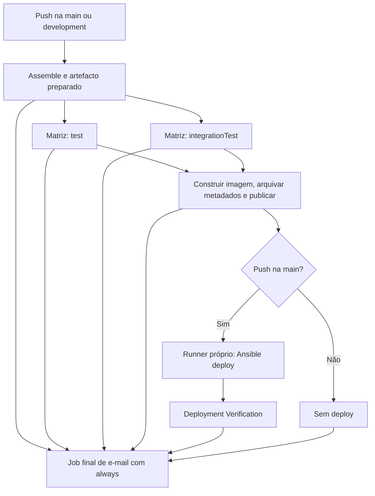

# CA5 — Solução alternativa com GitHub Actions

Nesta alternativa vais executar os mesmos objetivos da Parte 2 com GitHub Actions: compilar a Bookstore, testar, construir e publicar uma imagem identificada, implantar apenas a main por Ansible e verificar a aplicação. Reutilizas a aplicação, o Dockerfile e os playbooks de `CA5/Part2`, para comparar as ferramentas de CI/CD mantendo o trabalho da aplicação equivalente.

O workflow está em [`.github/workflows/ca5-bookstore.yml`](../../.github/workflows/ca5-bookstore.yml). Essa localização é obrigatória para o GitHub o reconhecer; os ficheiros de análise e de validação local ficam nesta pasta.

## 1. Análise e comparação

O GitHub Actions foi escolhido porque o repositório já está no GitHub e permite definir os eventos e dependências dos jobs no próprio repositório. O serviço gere a execução dos jobs hospedados e a distribuição de artefactos. O deploy para a VM local continua a precisar de um runner com acesso à rede do laboratório. O acompanhamento desta alternativa está na [issue #22](https://github.com/JP-142004/cogsi2627-1260168-1260204/issues/22).

| Aspeto | Jenkins da solução base | GitHub Actions da alternativa |
|---|---|---|
| Definição | Pipeline declarativo Groovy num Jenkinsfile | Workflow YAML em `.github/workflows` |
| Execução por branch | Projeto Multibranch e `checkout scm` | Evento push, contexto `github.ref` e condição no job |
| Disparo | Webhook ou Poll SCM; foi demonstrado Poll SCM local | Evento nativo do repositório, sem expor Jenkins |
| Compilação e testes | Ferramentas instaladas no nó Jenkins | Runners hospedados, com setup-java |
| Paralelismo | Bloco `parallel`, com pastas isoladas no nó | Matriz com dois jobs, cada um no seu runner |
| Distribuição | Precisa de agentes Jenkins disponíveis | Cada elemento da matriz pode ser executado num runner diferente |
| Partilha de ficheiros | `stash`/`unstash` dentro do pipeline | `upload-artifact`/`download-artifact` entre jobs |
| Resultados JUnit | Publicação integrada e histórico no Jenkins | XML/HTML como artefactos e contagens no Job Summary |
| Estados | SUCCESS, FAILURE e UNSTABLE | Testes falhados resultam em failure; não há estado UNSTABLE equivalente |
| Rastreabilidade | Artefactos e fingerprints, commit e tag de imagem | Artefactos do run, outputs, commit e tag com run ID e tentativa |
| Segredos | Jenkins Credentials | Secrets referidos apenas nos passos que os usam |
| Deploy na VM | SSH e Ansible no nó Jenkins | SSH e Ansible num self-hosted runner Linux |
| Notificação | Plugin Email Extension | SMTP com Python, executado num job final |
| Manutenção | Servidor, plugins, ferramentas, dados e agentes | Workflows e dependências; runner próprio de deploy continua a ser mantido pelo grupo |

### 1.1. Justificação e compromissos

Para este grupo, o Actions reduz a configuração necessária para reagir a commits: o evento pertence ao serviço que já aloja o repositório. Os jobs de compilação e testes podem usar runners hospedados, sem manter um servidor CI para essas tarefas.

Isso não elimina a infraestrutura local. Um runner hospedado não tem acesso direto à rede host-only da VM. A solução proposta usa um self-hosted runner Linux para o deploy. O processo desse runner e a VM têm de estar ligados; se o runner estiver indisponível, o job de deploy fica à espera de um executor compatível.

O Jenkins oferece uma apresentação JUnit mais integrada. No Actions, esta implementação publica os XML, relatórios HTML e um resumo de contagens por job, sem acrescentar uma ação de terceiros que necessite de permissões de escrita em checks. A visualização histórica não é equivalente à do Jenkins.

Também há uma diferença de resultado: no Jenkins, uma falha de testes fica UNSTABLE e bloqueia os stages seguintes; no Actions, faz falhar o job da matriz. Em ambos os casos a imagem não é publicada e não há deploy dessa versão. A notificação reflete o estado disponível na ferramenta.

## 2. Desenho da solução



### 2.1. Jobs e dependências

1. **assemble**: obtém o código, prepara Java 17, compila e empacota num artefacto o JAR executável e as classes e recursos de main.
2. **tests**: depende de assemble e usa uma matriz `task: [test, integrationTest]`, com `fail-fast: false`. Cada job recupera a compilação preparada, executa a sua tarefa, publica as contagens e arquiva os resultados, mesmo quando há uma falha.
3. **image**: só corre depois de assemble e dos dois elementos da matriz terem passado. Recupera o mesmo JAR, constrói a imagem, arquiva Dockerfile e metadados, autentica por stdin e faz push.
4. **deploy**: depende de image e exige simultaneamente `github.event_name == 'push'` e `github.ref == 'refs/heads/main'`. Corre num runner com as etiquetas `self-hosted`, `linux` e `ca5-production`, chama os playbooks e remove a chave SSH temporária em `always()`.
5. **notification**: depende dos jobs anteriores e usa `always()`, para enviar o resultado final por SMTP, incluindo quando há falhas ou deploy ignorado na development.

O evento `workflow_dispatch` permite executar manualmente a compilação e os testes; a condição do deploy não autoriza uma implantação por esse evento.

### 2.2. Identificação e artefactos

As imagens usam `gha-<branch>-<run_id>-<run_attempt>-<commit_curto>`. Assim distingues branches, repetições e reexecuções do mesmo run. O prefixo `gha` distingue esta alternativa do Jenkins.

O artefacto `prepared-app` contém um tar com o JAR e a compilação de main. Os jobs de teste e de imagem recuperam esse mesmo ficheiro. O tar também preserva os caminhos necessários para executar os testes sobre a compilação preparada, sem voltar a compilar main.

Os artefactos `junit-test` e `junit-integrationTest` guardam XML, HTML e intervalos de execução. `build-metadata` guarda o Dockerfile e `build.json`, com commit, branch, tag, data e SHA-256 do JAR. `published-image` guarda os digests observados depois do push.

## 3. Implementação

| Ficheiro | Responsabilidade |
|---|---|
| [Workflow](../../.github/workflows/ca5-bookstore.yml) | Eventos, matriz, dependências, condição de deploy, artefactos e notificação |
| [gradle.sh](../Part2/ci/gradle.sh) | Java 17, limites de memória e tempos dos comandos |
| [prepare-actions-image.py](../Part2/ci/prepare-actions-image.py) | Tag e outputs da imagem desta execução |
| [test-summary.py](../Part2/ci/test-summary.py) | Contagens JUnit no Job Summary |
| [image-metadata.py](../Part2/ci/image-metadata.py) | Dockerfile e metadados sem credenciais |
| [push-image.py](../Part2/ci/push-image.py) | Login por stdin, autenticação temporária e push |
| [deploy.sh](../Part2/ci/deploy.sh) | Chamar Ansible com imagem, host, porta e chave do gestor de credenciais |
| [notify-email.py](../Part2/ci/notify-email.py) | SMTP, TLS e resultado agregado dos jobs |
| [Playbooks](../Part2/ansible/README.md) | Instalação Docker, pull, substituição e health checks |

O workflow limita `GITHUB_TOKEN` a `contents: read`. A credencial de checkout não é persistida. As credenciais do registo são fornecidas ao passo de push e ao deploy; a chave SSH só é fornecida ao job de produção. Os scripts não imprimem os segredos nem os incluem nos artefactos.

As execuções da mesma branch são coordenadas por `concurrency`; o deploy tem ainda o grupo `ca5-production`. Isso coordena execuções do Actions, não coordena automaticamente outro servidor Jenkins. Nas demonstrações, as duas ferramentas são usadas separadamente para implantar na mesma VM.

## 4. Validação inteiramente local

Foi usado **act** para executar o workflow em Docker antes da publicação no GitHub. **actionlint** verifica a sintaxe, expressões, dependências e etiquetas do workflow. As ferramentas são instaladas apenas em `CA5/Part2/.local/tools`, com checksum SHA-256 verificado nas releases oficiais.

### 4.1. Preparar

Primeiro arranca o laboratório Jenkins, que disponibiliza também o registo local, a caixa SMTP e o túnel para a VM:

```powershell
cd CA5/Part2
.\jenkins\start-local.ps1 -RefreshScm
cd ../..
```

A partir da raiz do repositório:

```powershell
py -3 CA5/Alternative/install-local-tools.py
docker build -t cogsi-ca5-actions-runner:local -f CA5/Alternative/runner.Dockerfile CA5/Alternative
& CA5/Part2/.local/tools/actionlint.exe .github/workflows/ca5-bookstore.yml
```

O runner local reutiliza Java, Docker e Ansible da imagem Jenkins, acrescentando Node 24 para as ações atuais. `run-local.py` regista o intérprete Python 3.13 existente na cache do act. Isso permite executar setup-python num container Debian sem pedir um binário preparado para Ubuntu.

### 4.2. Executar

```powershell
py -3 CA5/Alternative/run-local.py --branch development
py -3 CA5/Alternative/run-local.py --branch main
```

Executa as duas demonstrações uma de cada vez. O script copia os ficheiros versionáveis para uma árvore de trabalho isolada em `.local/`, cria um commit de teste e prepara um evento local da branch escolhida. A branch de trabalho do grupo não é alterada.

As variáveis da emulação apontam para o registo `localhost:15000`, o SSH encaminhado pelo Vagrant e o Mailpit. Só são fornecidos segredos gerados para o laboratório e a chave da VM local. Não se usa um token de escrita do GitHub nem se faz push para o GitHub ou Docker Hub.

Os artefactos de cada execução ficam numa pasta própria em `.local/actions-artifacts/`. Isso impede que execuções repetidas encontrem artefactos antigos com o mesmo nome. Os artefactos volumosos, incluindo o JAR, não são commitados; as evidências publicáveis contêm os relatórios, metadados e logs relevantes.

Foi encontrada corrupção de ZIPs grandes no servidor de artefactos local: o número de bytes guardados era inferior ao anunciado pelo upload e o download falhava. A emulação define `ACTIONS_ARTIFACT_UPLOAD_CONCURRENCY=1`, serializando os blocos enviados ao servidor local. Esta variável é fornecida pelo script do act, sem alterar o workflow no GitHub. A validação também compara o SHA-256 do JAR recuperado com o metadado do build.

O script limita os jobs do emulador para controlar os recursos. A matriz e os ficheiros de tempos permitem observar a execução dos testes sem assumir que o agendamento local será idêntico ao do serviço GitHub.

### 4.3. Validar uma falha

```powershell
py -3 CA5/Alternative/run-local.py --branch development --scenario unit-failure
```

Esta opção altera a expectativa de um teste unitário apenas na cópia isolada. A execução do workflow deve falhar, publicar os resultados de teste e enviar a notificação de falha, sem criar ou publicar uma imagem dessa versão e sem alterar a produção. O código do repositório principal mantém o teste correto. Um código de saída diferente de zero é esperado neste cenário.

### 4.4. Resultados e evidências

As execuções locais, os resultados JUnit, os metadados da imagem, o hash do JAR partilhado e as notificações recebidas são registados em `evidence/`. Os ficheiros `01-act-main.json` e `01-act-development.json` identificam explicitamente o fornecedor como `act-local-emulation`, incluindo commit de teste e run ID.

A emulação da main executou deploy e verificação por Ansible na VM. Na development, o estado da produção é comparado antes e depois da execução. A ausência de alteração do ID e da imagem constitui uma verificação adicional à condição do job.

| Evidência | Conteúdo |
|---|---|
| [01-act-main.txt](evidence/01-act-main.txt) | Workflow completo da main, incluindo deploy e verificação |
| [01-act-main.json](evidence/01-act-main.json) | Identidade e resultado da emulação main |
| [01-act-development.txt](evidence/01-act-development.txt) | Workflow development, com imagem publicada localmente e sem deploy |
| [01-act-development.json](evidence/01-act-development.json) | Resultado e comparação da produção antes/depois |
| [02-act-development-unit-failure.json](evidence/02-act-development-unit-failure.json) | Falha unitária deliberada, sem alteração da produção |
| [03-local-validation-summary.json](evidence/03-local-validation-summary.json) | JUnit, intervalos, integridade do JAR, imagem e e-mails |
| [04-final-local-checks.json](evidence/04-final-local-checks.json) | Sintaxe, ligações, ausência de segredos locais e aplicação UP |

Os ficheiros `-build.json` e `-push.json` guardam os metadados recuperados dos artefactos da própria execução. Os resultados do cenário de falha ficam em `02-act-development-unit-failure.*`.

Na main e na development passaram os três testes (um unitário e dois de integração). No cenário negativo falhou o teste unitário, os dois de integração passaram e os jobs de imagem e deploy foram bloqueados. A notificação FAILURE foi recebida e a produção manteve o mesmo container saudável. Os intervalos dos comandos sobrepuseram-se em 7,362 segundos na main e 3,945 segundos na development; estes valores demonstram concorrência local, sem constituir uma comparação de desempenho com o serviço GitHub.

Na primeira notificação negativa, o act devolveu uma expressão por avaliar como output do job de imagem ignorado. O envio foi ajustado para apresentar `não construída` quando esse job não termina com sucesso; uma nova chamada SMTP com o mesmo cenário confirmou o resultado corrigido. O log original foi preservado.

Para verificar os dados gravados, depois de executar os cenários:

```powershell
py -3 CA5/Alternative/collect-local-evidence.py --include-failure
```

## 5. Configuração posterior no GitHub

Depois da validação local, foi autorizada a publicação exclusivamente na branch `ca5-part2`. O evento push inclui essa branch para testar o serviço GitHub Actions sem integrar código na main. O deploy continua condicionado à main. Alterações apenas a Markdown ou às pastas de evidências não repetem os jobs.

Os Secrets `DOCKERHUB_USERNAME` e `DOCKERHUB_TOKEN` foram configurados com autorização explícita. A chave SSH fica exclusivamente local, por decisão do utilizador. Os parâmetros Microsoft 365 foram definidos, mas a autorização de envio ainda não está disponível. Não se considera o e-mail externo validado enquanto não houver autenticação e receção confirmadas.

### 5.1. Secrets

| Nome | Conteúdo |
|---|---|
| `DOCKERHUB_USERNAME` | Utilizador Docker Hub |
| `DOCKERHUB_TOKEN` | Access token com permissão para publicar a imagem |
| `CA5_PRODUCTION_SSH_KEY` | Opcional para outro modo de configuração; não criado nesta entrega: a chave foi mantida local |
| `SMTP_USERNAME` | Utilizador do servidor SMTP, quando há autenticação |
| `SMTP_PASSWORD` | Credencial SMTP, quando há autenticação |
| `SMTP_OAUTH_CLIENT_SECRET` | Segredo de uma aplicação Microsoft Entra autorizada a enviar por SMTP, no modo OAuth |

### 5.2. Variables

| Nome | Valor ou finalidade |
|---|---|
| `CA5_IMAGE_REPOSITORY` | Por omissão, `luizbsilv/ca5-bookstore` |
| `CA5_REGISTRY_URL` | Por omissão, Docker Hub HTTPS |
| `CA5_PRODUCTION_HOST` | IP ou host SSH acessível a partir do runner |
| `CA5_PRODUCTION_SSH_PORT` | Porta SSH; por omissão, 22 |
| `SMTP_HOST`, `SMTP_PORT` | Servidor de envio de e-mail |
| `SMTP_STARTTLS`, `SMTP_SSL` | Modo TLS; por omissão STARTTLS e porta 587 |
| `NOTIFY_FROM`, `NOTIFY_TO` | Remetente autorizado e destinatário real |
| `SMTP_USERNAME` | Caixa de correio de envio; também pode ser fornecida como Secret |
| `SMTP_OAUTH_TENANT_ID`, `SMTP_OAUTH_CLIENT_ID` | Tenant e aplicação Microsoft Entra, quando é usado OAuth |

Para SMTP com SSL direto, configura a porta adequada e `SMTP_SSL=true`. A implementação usa SSL direto quando esse modo é escolhido. O modo sem TLS usado pelo Mailpit é exclusivo da validação local.

Para a conta institucional Microsoft 365 foi preparado `smtp.office365.com:587`, com STARTTLS. O script suporta OAuth com client credentials: obtém um access token por HTTPS e autentica por XOAUTH2. Isso exige uma aplicação Entra, autorização `SMTP.SendAsApp`, consentimento administrativo e acesso à caixa, conforme a [documentação Microsoft](https://learn.microsoft.com/en-us/exchange/client-developer/legacy-protocols/how-to-authenticate-an-imap-pop-smtp-application-by-using-oauth). A disponibilidade SMTP depende das políticas do ISEP; não foi alterada qualquer política institucional. Não se assume que a palavra-passe habitual do Outlook permita enviar por SMTP.

Sem credenciais de envio, o job de notificação falha com uma mensagem de configuração explícita. A compilação, os testes e a publicação da imagem mantêm resultados independentes. Os seis testes em `ci/test_notify_email.py` exercitam a seleção do estado, o caso de imagem ignorada, a exigência de autenticação/TLS, XOAUTH2 e a ausência de segredos nos erros. O fluxo OAuth foi simulado nesses testes; a autorização real Microsoft ainda precisa de validação.

### 5.3. Runner de produção

Regista um self-hosted runner Linux nas definições Actions do repositório e acrescenta a etiqueta `ca5-production`. Usa os comandos fornecidos pelo GitHub para a tua máquina, mantendo o token de registo fora dos ficheiros do trabalho.

Confirma que o runner consegue alcançar o SSH da VM. Se correr num container Docker Desktop, usa o encaminhamento do Vagrant e as variáveis de host/porta, como foi feito no laboratório. O workflow prepara Python 3.13 e Ansible Core 2.19.4; a compilação continua em Java 17 nos runners de build.

Antes de demonstrar o deploy desta alternativa, suspende o job de deploy Jenkins que utiliza a mesma VM. O registo do runner exige acesso administrativo ao repositório. A conta atual tem permissão de push, mas a API de runners devolveu HTTP 403. O administrador terá de registar esse runner.

Foi preparada e construída a [configuração do runner em Docker](production-runner/README.md), com versão oficial identificada por digest. A ligação SSH à VM foi exercitada localmente com o utilizador sem privilégios do runner. A chave é montada localmente e copiada temporariamente pelo workflow através de `CA5_LOCAL_SSH_KEY`; não foi enviada para o GitHub. O runner só ficará disponível para jobs depois do registo administrativo.

Enquanto a integração não for autorizada, mantém as alterações na `ca5-part2`. A execução real da main e a tag final ficam pendentes; não substituas a condição de deploy para fazer uma demonstração na branch de trabalho.

### 5.4. Execução real na branch de trabalho

O [run 43290201961](https://github.com/JP-142004/cogsi2627-1260168-1260204/actions/runs/43290201961) foi disparado por push na `ca5-part2`, no commit `2638c92`. Assemble, os dois jobs da matriz e Build/archive/push passaram. Os três testes da aplicação passaram; o SHA-256 do JAR recuperado foi comparado com o metadado e o digest da imagem foi confirmado no Docker Hub. O deploy ficou skipped.

O resultado global foi **failure**, devido ao job de notificação: os parâmetros Microsoft 365 estão definidos, mas falta a credencial/autorização de envio. Esta falha é preservada nas evidências; não é apresentada como um pipeline totalmente aprovado.

| Evidência | Resultado |
|---|---|
| [05-github-configuration.json](evidence/05-github-configuration.json) | Nomes dos Secrets e configuração sem os seus valores secretos |
| [06-github-43290201961.json](evidence/06-github-43290201961.json) | Jobs reais, JUnit, JAR, imagem e digest |
| [06-github-43290201961.txt](evidence/06-github-43290201961.txt) | Logs da execução real, incluindo a falha SMTP |
| [07-production-runner-local-check.txt](evidence/07-production-runner-local-check.txt) | Binário do runner, utilizador, Python e SSH locais; sem registo GitHub |

Para recolher outra execução concluída desta branch:

```powershell
py -3 CA5/Alternative/collect-github-evidence.py ID_DA_EXECUCAO
```

## 6. Limitações e reflexão

| Aspeto | Cobertura e limite |
|---|---|
| Compilação, testes, artefactos, imagem e Ansible | Implementados no workflow e executados por act com serviços locais |
| Eventos GitHub reais | Push na ca5-part2 demonstrado; main ainda sem integração |
| Checkout do GitHub | Exercitado no repositório público; um futuro repositório privado exige permissões adequadas |
| Artefactos do serviço GitHub | Upload, download e integridade do JAR exercitados; retenção configurada para sete dias |
| Docker Hub no workflow | Imagem publicada pelo serviço GitHub e digest confirmado |
| Self-hosted runner registado | Imagem construída e SSH local validado; registo bloqueado pela falta de acesso administrativo |
| E-mail externo | Captura Mailpit validada; Microsoft 365 preparado, mas sem autorização de envio; job externo falha explicitamente |
| Estado UNSTABLE | Não existe equivalente direto no Actions; um teste falhado gera failure e bloqueia publicação/deploy |
| Persistência H2 | Mantém a limitação da solução base: dados em memória perdem-se ao substituir o container |
| Duas ferramentas sobre a mesma produção | Não há um bloqueio comum entre Jenkins e Actions; as demonstrações usam um responsável de deploy de cada vez |

A alternativa está implementada como workflow executável, não apenas desenhada. A emulação permite validar grande parte do percurso antes de publicar, mas não substitui a prova de uma execução alojada no GitHub. Essa distinção mantém os resultados locais separados dos requisitos que dependem da integração externa.

## 7. Referências

- [Sintaxe de workflows GitHub Actions](https://docs.github.com/en/actions/reference/workflows-and-actions/workflow-syntax)
- [Artefactos entre jobs](https://docs.github.com/en/actions/tutorials/store-and-share-data)
- [Runners próprios](https://docs.github.com/en/actions/reference/runners/self-hosted-runners)
- [Secrets](https://docs.github.com/en/actions/concepts/security/secrets)
- [setup-java](https://github.com/actions/setup-java)
- [setup-python](https://github.com/actions/setup-python)
- [act: execução local e artefactos](https://nektosact.com/usage/index.html)
- [actionlint](https://github.com/rhysd/actionlint)
- [Configuração da concorrência de upload no toolkit oficial](https://github.com/actions/toolkit/blob/main/packages/artifact/RELEASES.md)
- [Problema de corrupção de artefactos no act](https://github.com/nektos/act/issues/2351)
- [Microsoft 365: configuração SMTP e STARTTLS](https://learn.microsoft.com/en-us/exchange/mail-flow-best-practices/how-to-set-up-a-multifunction-device-or-application-to-send-email-using-microsoft-365-or-office-365)
- [Microsoft 365: OAuth SMTP e permissões](https://learn.microsoft.com/en-us/exchange/client-developer/legacy-protocols/how-to-authenticate-an-imap-pop-smtp-application-by-using-oauth)
