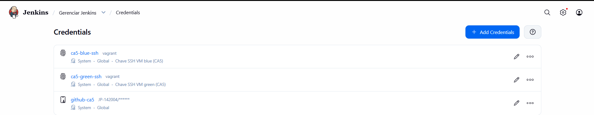
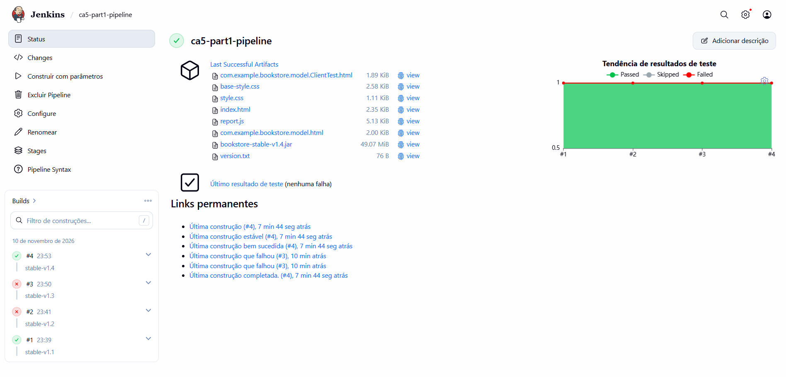
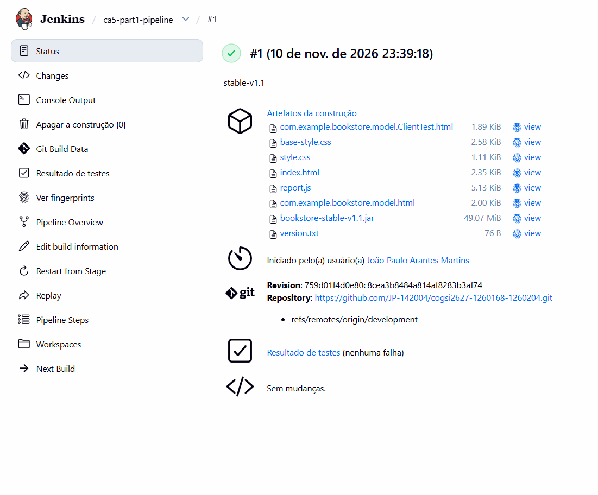
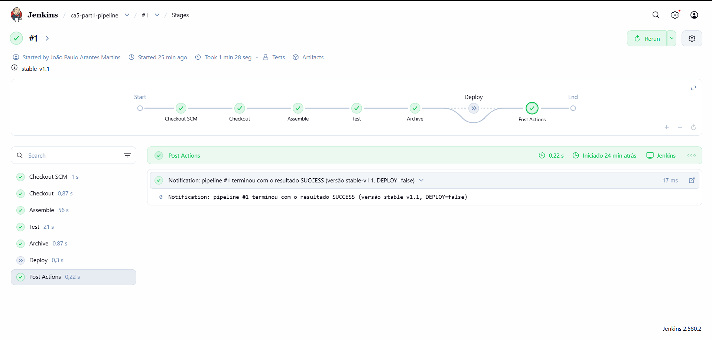
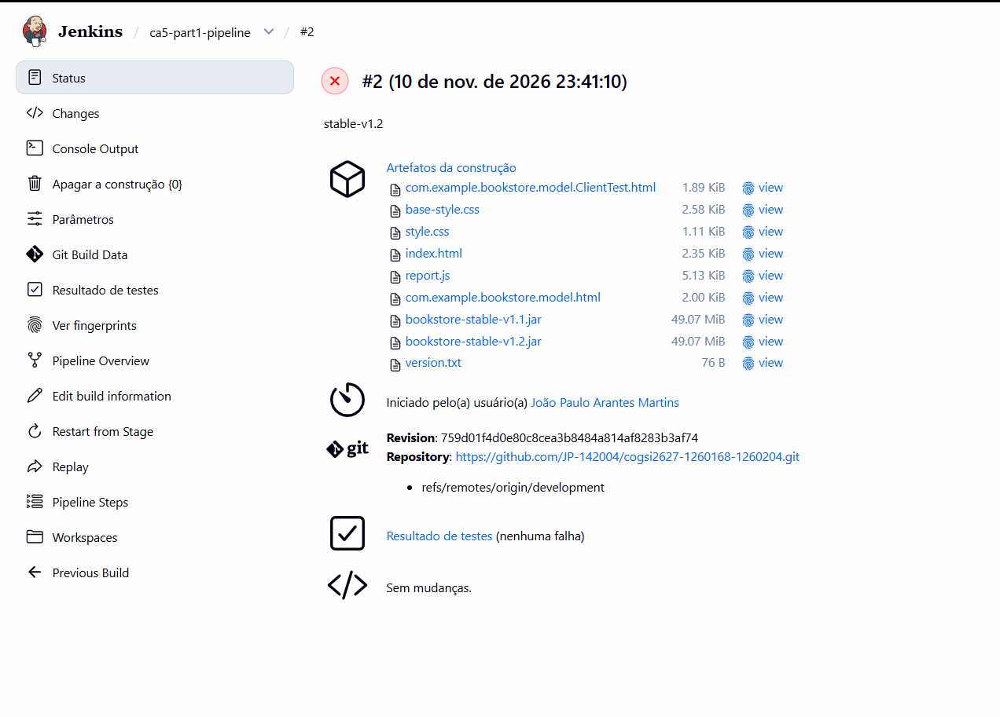
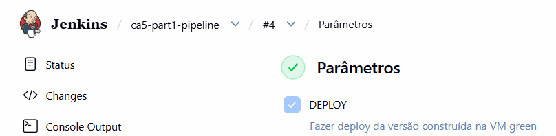
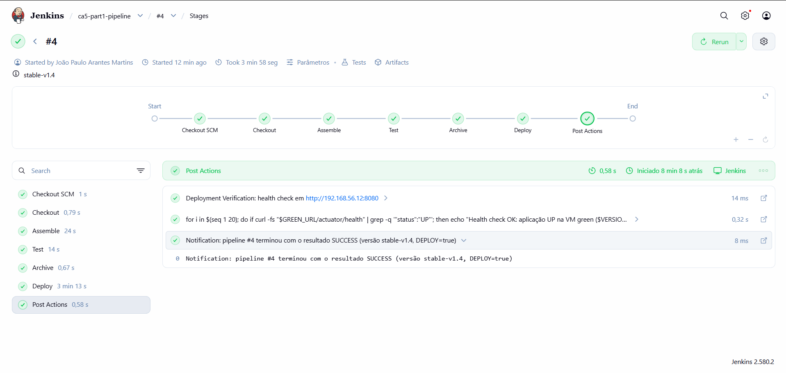
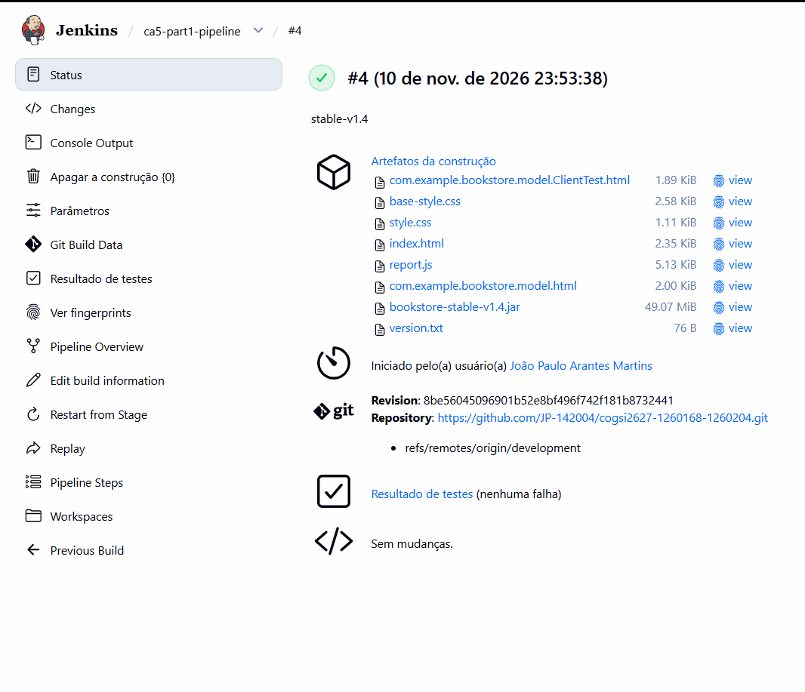
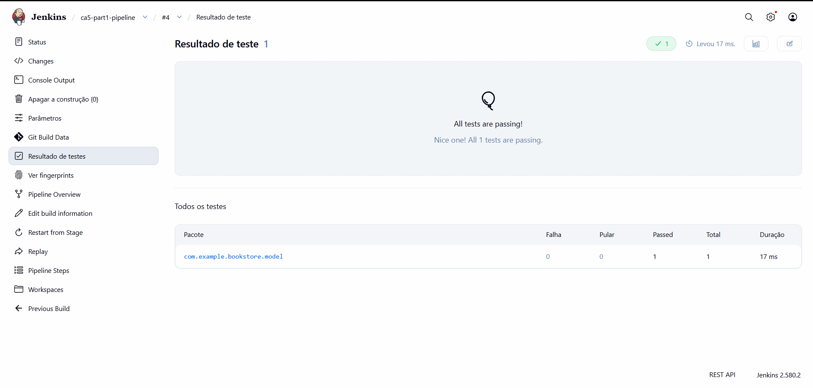

# CA5 — Parte 1 · Pipeline Jenkins com deploy blue/green em VMs

Neste tutorial vais construir um pipeline CI/CD para a versão Gradle da aplicação Bookstore. O pipeline corre num Jenkins instalado no host, compila e testa a aplicação, arquiva o JAR com um identificador de versão e, quando pedes, implanta essa versão numa máquina virtual com Ansible. No fim vais restaurar uma versão anterior com um playbook de rollback que vai buscar o artefacto diretamente ao Jenkins.

A infraestrutura simula um fluxo **blue/green** simplificado. Há duas VMs com a mesma configuração. A **blue** representa o ambiente ativo, com a versão atual da aplicação. A **green** é o ambiente candidato, onde o Jenkins implanta e valida cada nova versão. A troca de tráfego entre as duas e o balanceamento de carga ficam fora do âmbito do trabalho, tal como a monitorização da aplicação. Tal como na Parte 1 do CA2, a aplicação e a base de dados H2 correm dentro da mesma VM.

## Índice

1. [Arquitetura](#1-arquitetura)
2. [Preparar o host](#2-preparar-o-host)
3. [Adicionar a aplicação ao repositório](#3-adicionar-a-aplicação-ao-repositório)
4. [Criar as VMs blue e green com Vagrant](#4-criar-as-vms-blue-e-green-com-vagrant)
5. [Provisionar e implantar com Ansible](#5-provisionar-e-implantar-com-ansible)
6. [Instalar o Jenkins no host](#6-instalar-o-jenkins-no-host)
7. [Guardar as credenciais no Jenkins](#7-guardar-as-credenciais-no-jenkins)
8. [Escrever o Jenkinsfile](#8-escrever-o-jenkinsfile)
9. [Criar o job e executar o pipeline](#9-criar-o-job-e-executar-o-pipeline)
10. [Fazer rollback para uma versão estável](#10-fazer-rollback-para-uma-versão-estável)
11. [Problemas encontrados e soluções](#11-problemas-encontrados-e-soluções)
12. [Justificação das opções](#12-justificação-das-opções)
13. [Terminar e retomar o ambiente](#13-terminar-e-retomar-o-ambiente)
14. [Mapa de requisitos](#14-mapa-de-requisitos)

## 1. Arquitetura

```text
                         Host Windows
 ┌──────────────────────────────────────────────────────────────┐
 │  WSL 2 · Ubuntu 22.04                                        │
 │  ┌────────────────────────────┐                              │
 │  │ Jenkins 2.580.2 (Java 21)  │  git clone  ──► GitHub       │
 │  │  └─ job ca5-part1-pipeline │             (branch          │
 │  │       Gradle (Java 17)     │              development)    │
 │  │       Ansible 2.17         │                              │
 │  └────────────┬───────────────┘                              │
 │               │ SSH (chave no Jenkins Credentials)           │
 │  VirtualBox   ▼  rede host-only 192.168.56.0/24              │
 │  ┌────────────────────────┐   ┌────────────────────────┐     │
 │  │ cogsi-ca5-blue  .11    │   │ cogsi-ca5-green  .12   │     │
 │  │ ambiente ativo         │   │ ambiente candidato     │     │
 │  │ bookstore.service:8080 │   │ bookstore.service:8080 │     │
 │  │ H2 em memória          │   │ H2 em memória          │     │
 │  └────────────────────────┘   └────────────────────────┘     │
 └──────────────────────────────────────────────────────────────┘
```

O percurso de uma alteração é o seguinte. O código entra na branch `development`. O Jenkins clona essa branch, compila com o Gradle Wrapper, corre os testes unitários e publica os resultados. Se os testes passarem, arquiva o JAR com o nome `bookstore-stable-v1.<build>.jar`. Com o parâmetro `DEPLOY` ativo, chama o Ansible, que copia esse JAR para a VM green, reinicia o serviço e espera que `/actuator/health` responda `UP`. O rollback faz o caminho inverso: lê do Jenkins um build anterior e repõe-no na green.

Estrutura da pasta:

```text
CA5/Part1/
├── README.md                  este tutorial
├── Vagrantfile                VMs blue e green
├── Jenkinsfile                definição do pipeline
├── .gitignore
├── bookstore/                 aplicação Bookstore (Gradle, cópia de CA1/week2)
├── ansible/
│   ├── hosts.ini              inventário das duas VMs
│   ├── provision.yml          Java 17, utilizador e serviço systemd
│   ├── deploy-blue.yml        deploy da versão atual na blue
│   ├── deploy-green.yml       deploy usado pelo Jenkins na green
│   ├── rollback.yml           restauro de uma versão estável do Jenkins
│   ├── tasks/deploy-app.yml   tarefas comuns de deploy
│   └── templates/bookstore.service.j2
└── evidence/                  outputs e capturas de cada etapa
```

## 2. Preparar o host

O trabalho foi feito em Windows com VirtualBox 7.2 e Vagrant. O Ansible não corre nativamente em Windows, por isso o Ansible e o Jenkins correm numa distribuição Ubuntu dentro do **WSL 2**. O WSL alcança a rede host-only do VirtualBox, o que permite ao Jenkins chegar diretamente às VMs pelos IPs privados.

Instala a distribuição a partir do PowerShell:

```powershell
wsl --install -d Ubuntu-22.04
wsl -l -v
```

O Jenkins vai correr como serviço, por isso o WSL tem de arrancar com systemd. Confirma dentro do Ubuntu:

```bash
ps -p 1 -o comm=
```

Se a resposta for `systemd`, não precisas de alterar nada. Caso contrário, cria `/etc/wsl.conf` com a secção `[boot]` e a linha `systemd=true` e reinicia o WSL com `wsl --shutdown`.

Instala o Ansible a partir do PPA oficial e confirma que o Ubuntu chega às duas VMs (criadas no passo 4):

```bash
sudo apt update
sudo apt install -y software-properties-common
sudo add-apt-repository --yes --update ppa:ansible/ansible
sudo apt install -y ansible
ansible --version          # ansible [core 2.17.14]
ping -c 2 192.168.56.11
ping -c 2 192.168.56.12
```

## 3. Adicionar a aplicação ao repositório

Trabalha numa branch própria, como nos CAs anteriores:

```powershell
git checkout main
git pull
git checkout -b ca5-part1
```

A aplicação é a versão Gradle da Bookstore desenvolvida no CA1 (`CA1/week2`). Copia-a para `CA5/Part1/bookstore`, deixando de fora os artefactos de compilação, a cache do Gradle, o histórico Git e a variante Maven:

```powershell
robocopy CA1\week2 CA5\Part1\bookstore /E /XD build .gradle .git maven-alternative bin out
```

O `robocopy` devolve o código 1 quando copia ficheiros com sucesso. Confirma que a aplicação compila e que os testes passam:

```powershell
cd CA5\Part1\bookstore
.\gradlew.bat clean bootJar test
dir app\build\libs
```

O Gradle produz `app-1.0.0.jar`, o JAR executável do Spring Boot, e `app-1.0.0-plain.jar`, que só contém as classes da aplicação. O pipeline usa o primeiro. O `build.gradle` define um *toolchain* Java 17, por isso a compilação usa sempre o JDK 17, seja qual for o Java que lança o Gradle.

No Windows, o ficheiro `gradlew` perde a permissão de execução quando é adicionado ao Git. Como o Jenkins corre em Linux, marca-o como executável no índice antes do primeiro commit:

```powershell
git update-index --chmod=+x CA5/Part1/bookstore/gradlew
```

O commit mostra `create mode 100755 CA5/Part1/bookstore/gradlew`.

## 4. Criar as VMs blue e green com Vagrant

O [`Vagrantfile`](Vagrantfile) define as duas máquinas num único ciclo, para garantir que têm exatamente a mesma configuração. Só mudam o nome e o IP.

```ruby
Vagrant.configure("2") do |config|
  config.vm.box = "ubuntu/jammy64"
  config.vm.box_version = "20241002.0.0"
  config.vm.synced_folder ".", "/vagrant", disabled: true
  config.ssh.insert_key = true

  VMS = {
    "blue"  => "192.168.56.11",
    "green" => "192.168.56.12"
  }

  VMS.each do |name, ip|
    config.vm.define name do |node|
      node.vm.hostname = "cogsi-ca5-#{name}"
      node.vm.network "private_network", ip: ip
      node.vm.provider "virtualbox" do |vb|
        vb.name   = "cogsi-ca5-#{name}"
        vb.memory = 1024
        vb.cpus   = 1
      end
    end
  end
end
```

A box e a versão são as mesmas do CA3, que já estavam em cache. A pasta partilhada `/vagrant` fica desativada porque a aplicação chega às VMs através do Ansible e não de uma pasta montada. `ssh.insert_key = true` faz o Vagrant substituir a chave insegura por uma chave própria em cada VM. São essas chaves que o Ansible e o Jenkins vão usar.

Levanta as máquinas e valida o acesso:

```powershell
cd CA5\Part1
vagrant up
vagrant status
vagrant ssh blue  -c "hostname; hostname -I"
vagrant ssh green -c "hostname; hostname -I"
```

```text
blue                      running (virtualbox)
green                     running (virtualbox)

cogsi-ca5-blue
10.0.2.15 192.168.56.11
cogsi-ca5-green
10.0.2.15 192.168.56.12
```

O aviso sobre a versão das *Guest Additions* durante o arranque não afeta este trabalho, porque só interfere com pastas partilhadas, que estão desativadas. O [`.gitignore`](.gitignore) exclui a pasta `.vagrant/`, onde ficam o estado das VMs e as chaves privadas.

Evidências: [estado das VMs](evidence/01-vagrant-status.txt) · [SSH blue](evidence/01-vagrant-ssh-blue.txt) · [SSH green](evidence/01-vagrant-ssh-green.txt)

### Preparar as chaves SSH para o Ansible

O comando `vagrant ssh-config` mostra onde estão as chaves de cada VM. No WSL, os ficheiros do Windows aparecem com permissões `777`, e o cliente SSH recusa chaves privadas com permissões tão abertas. Copia-as para dentro do Ubuntu e restringe o acesso:

```bash
mkdir -p ~/.ssh/ca5
cp /mnt/c/Projetos/cogsi2627-1260168-1260204/CA5/Part1/.vagrant/machines/blue/virtualbox/private_key  ~/.ssh/ca5/blue_key
cp /mnt/c/Projetos/cogsi2627-1260168-1260204/CA5/Part1/.vagrant/machines/green/virtualbox/private_key ~/.ssh/ca5/green_key
chmod 600 ~/.ssh/ca5/*_key
ssh -i ~/.ssh/ca5/blue_key  vagrant@192.168.56.11 hostname   # cogsi-ca5-blue
ssh -i ~/.ssh/ca5/green_key vagrant@192.168.56.12 hostname   # cogsi-ca5-green
```

As chaves ficam fora do repositório. Para execuções manuais, o inventário aponta para `~/.ssh/ca5/`. No pipeline, a chave vem do Jenkins Credentials (passo 7).

## 5. Provisionar e implantar com Ansible

### Inventário

O [`hosts.ini`](ansible/hosts.ini) agrupa as VMs em `blue` e `green` e junta-as no grupo `bookstore`, onde ficam as variáveis comuns:

```ini
[blue]
cogsi-ca5-blue ansible_host=192.168.56.11 ansible_ssh_private_key_file=~/.ssh/ca5/blue_key

[green]
cogsi-ca5-green ansible_host=192.168.56.12 ansible_ssh_private_key_file=~/.ssh/ca5/green_key

[bookstore:children]
blue
green

[bookstore:vars]
ansible_user=vagrant
ansible_ssh_common_args='-o StrictHostKeyChecking=no -o UserKnownHostsFile=/dev/null'
ansible_python_interpreter=/usr/bin/python3
```

A pasta do projeto está em `/mnt/c`, que o WSL apresenta como *world-writable*. Por segurança, o Ansible ignora qualquer `ansible.cfg` em pastas com essas permissões. Por isso as opções de SSH ficam no próprio inventário, onde são sempre lidas. A verificação da *host key* fica desativada porque as VMs são recriadas com frequência e mudam de chave em cada `vagrant destroy`.

### Provisionamento das duas VMs

O [`provision.yml`](ansible/provision.yml) prepara as duas máquinas da mesma forma:

| Tarefa | Porquê |
| --- | --- |
| Instala `openjdk-17-jre-headless` e `curl` | O JAR foi compilado para Java 17. Só é preciso o ambiente de execução, sem compilador. |
| Cria o utilizador de sistema `bookstore`, sem shell nem home | A aplicação não corre como `root` nem como `vagrant`. |
| Cria `/opt/bookstore`, pertencente a `bookstore` | É a pasta do JAR e do ficheiro `VERSION`. |
| Instala a unit systemd a partir do template | O serviço arranca com a VM e é reiniciado se o processo falhar. |
| Faz `daemon-reload` e ativa o serviço | O systemd passa a conhecer a unit nova. |

O template [`bookstore.service.j2`](ansible/templates/bookstore.service.j2) define o serviço:

```ini
[Service]
User=bookstore
WorkingDirectory=/opt/bookstore
ExecStart=/usr/bin/java -jar /opt/bookstore/bookstore.jar --server.port=8080
SuccessExitStatus=143
Restart=on-failure
RestartSec=5
```

`SuccessExitStatus=143` diz ao systemd que o código de saída da JVM quando recebe `SIGTERM` é uma paragem normal, e não uma falha. Sem esta linha, cada deploy deixaria o serviço marcado como *failed*. O nome do ambiente na descrição do serviço (`blue` ou `green`) vem do grupo do inventário a que a VM pertence.

### Deploy

Os dois playbooks de deploy partilham as mesmas tarefas, definidas em [`tasks/deploy-app.yml`](ansible/tasks/deploy-app.yml). Só muda o grupo de destino. [`deploy-blue.yml`](ansible/deploy-blue.yml) implanta a versão atual no ambiente ativo, e [`deploy-green.yml`](ansible/deploy-green.yml) é o que o Jenkins chama. Ambos recebem o caminho do JAR em `jar_path` e o identificador da versão em `version`.

As tarefas comuns executam esta sequência:

1. Confirmam que o JAR existe no controlador, antes de tocar na VM.
2. Param o serviço.
3. Esperam que a porta 8080 seja libertada (`wait_for state=stopped`).
4. Copiam o JAR para `/opt/bookstore/bookstore.jar`.
5. Escrevem a versão em `/opt/bookstore/VERSION`, para se saber sempre o que está a correr.
6. Arrancam o serviço.
7. Fazem um health check: pedem `/actuator/health` até 20 vezes, com 5 segundos de intervalo, até a resposta ser `UP`.

Executa o provisionamento e o deploy inicial no WSL:

```bash
cd /mnt/c/Projetos/cogsi2627-1260168-1260204/CA5/Part1/ansible
JAR=$(ls ../bookstore/app/build/libs/*.jar | grep -v plain)

ansible -i hosts.ini bookstore -m ping
ansible-playbook -i hosts.ini provision.yml
ansible-playbook -i hosts.ini deploy-blue.yml  -e "jar_path=$JAR version=v1.0.0"
ansible-playbook -i hosts.ini deploy-green.yml -e "jar_path=$JAR version=v1.0.0"

curl http://192.168.56.11:8080/actuator/health    # {"status":"UP"}
curl http://192.168.56.12:8080/actuator/health    # {"status":"UP"}
```

No health check vais ver várias linhas `FAILED - RETRYING`. Não são erros: o Spring Boot demora cerca de um minuto a arrancar numa VM com um único CPU, e os retries existem para esperar por esse arranque. Na execução registada, a aplicação respondeu `UP` à 12.ª tentativa.

Executar o provisionamento uma segunda vez dá `changed=0` nas duas VMs. Isto mostra que o playbook é **idempotente**: descreve um estado final e só altera o que estiver diferente desse estado.

```text
PLAY RECAP *********************************************************************
cogsi-ca5-blue             : ok=6    changed=0    unreachable=0    failed=0
cogsi-ca5-green            : ok=6    changed=0    unreachable=0    failed=0
```

Evidências: [provisionamento idempotente](evidence/02-ansible-provision.txt) · [versão e estado do serviço na blue](evidence/02-ansible-blue-status.txt) · [health blue](evidence/02-health-blue.txt) · [health green](evidence/02-health-green.txt)

## 6. Instalar o Jenkins no host

O Jenkins é instalado no Ubuntu do WSL, a partir do repositório oficial LTS:

```bash
sudo apt install -y openjdk-17-jdk fontconfig
curl -fsSL https://pkg.jenkins.io/debian-stable/jenkins.io-2026.key | sudo tee /usr/share/keyrings/jenkins-keyring.asc > /dev/null
echo "deb [signed-by=/usr/share/keyrings/jenkins-keyring.asc] https://pkg.jenkins.io/debian-stable binary/" | sudo tee /etc/apt/sources.list.d/jenkins.list > /dev/null
sudo apt update
sudo apt install -y jenkins
```

A versão instalada foi a **2.580.2**, que exige Java 21 ou 25. Instala o Java 21 e indica-o ao serviço através de um ficheiro *drop-in* do systemd, sem editar a unit do pacote. Assim, a configuração sobrevive às atualizações do Jenkins:

```bash
sudo apt install -y openjdk-21-jdk-headless
sudo mkdir -p /etc/systemd/system/jenkins.service.d
printf '[Service]\nEnvironment="JAVA_HOME=/usr/lib/jvm/java-21-openjdk-amd64"\n' | sudo tee /etc/systemd/system/jenkins.service.d/override.conf
sudo systemctl daemon-reload
sudo systemctl reset-failed jenkins
sudo systemctl restart jenkins
systemctl status jenkins --no-pager      # Active: active (running)
```

O Java 21 serve apenas para executar o Jenkins. A aplicação continua a ser compilada com Java 17, porque o toolchain do Gradle seleciona o JDK 17 em `/usr/lib/jvm`, e as VMs correm-na com o JRE 17.

Abre `http://localhost:8080` no navegador do Windows, introduz a palavra-passe de `/var/lib/jenkins/secrets/initialAdminPassword`, escolhe **Install suggested plugins** e cria o utilizador administrador. Depois, em **Gerenciar Jenkins → Plugins → Available plugins**, instala também **SSH Agent** e **Pipeline Utility Steps**. O primeiro fornece o tipo de credencial *SSH Username with private key*.

## 7. Guardar as credenciais no Jenkins

O enunciado proíbe credenciais escritas no repositório ou no Jenkinsfile. Todas as credenciais ficam no **Jenkins Credentials**, e o pipeline só as refere pelo ID. Cria-as em **Gerenciar Jenkins → Credentials → System → Global credentials → Add Credentials**.

| ID | Tipo | Conteúdo | Usada em |
| --- | --- | --- | --- |
| `github-ca5` | Username with password | Utilizador do GitHub e um *fine-grained token* com acesso apenas a este repositório e permissão **Contents: Read-only** | Checkout do repositório privado |
| `ca5-green-ssh` | SSH Username with private key | Utilizador `vagrant` e a chave privada da VM green | Stage Deploy |
| `ca5-blue-ssh` | SSH Username with private key | Utilizador `vagrant` e a chave privada da VM blue | Reservada para operações na blue |

O token do GitHub tem o mínimo de permissões necessário: só lê o código deste repositório e expira em 30 dias.

Para colar uma chave SSH sem a corromper, copia-a com `cat ~/.ssh/ca5/green_key | clip.exe` e não pela seleção do terminal (ver [problema 3](#11-problemas-encontrados-e-soluções)).



## 8. Escrever o Jenkinsfile

O [`Jenkinsfile`](Jenkinsfile) usa a sintaxe declarativa. As secções são descritas a seguir pela ordem em que aparecem no ficheiro.

### Parâmetro e variáveis

```groovy
parameters {
    booleanParam(name: 'DEPLOY', defaultValue: false,
                 description: 'Fazer deploy da versão construída na VM green')
}

environment {
    REPO_URL    = 'https://github.com/JP-142004/cogsi2627-1260168-1260204.git'
    APP_DIR     = 'CA5/Part1/bookstore'
    ANSIBLE_DIR = 'CA5/Part1/ansible'
    VERSION     = "stable-v1.${env.BUILD_NUMBER}"
    GREEN_URL   = 'http://192.168.56.12:8080'
}
```

O parâmetro `DEPLOY` começa desligado, para que uma execução sem escolha explícita nunca altere a VM. `VERSION` junta um prefixo fixo ao número do build do Jenkins. Isso torna cada identificador único e crescente (`stable-v1.1`, `stable-v1.2`, …) e associa-o diretamente ao build que o produziu. `disableConcurrentBuilds()` impede que dois builds façam deploy na green ao mesmo tempo.

### Stages

| Stage | O que faz |
| --- | --- |
| **Checkout** | `git branch: 'development', credentialsId: 'github-ca5'` vai buscar a versão mais recente da branch de desenvolvimento. |
| **Assemble** | `./gradlew clean assemble --no-daemon` compila e produz os JARs. `clean` garante que não sobram classes de um build anterior. `--no-daemon` evita deixar processos do Gradle vivos no agente. |
| **Test** | `./gradlew test --no-daemon` corre os testes unitários. Num bloco `post { always }`, o passo `junit` publica os relatórios XML, mesmo que haja falhas, para que o Jenkins mostre quais os testes que falharam. |
| **Archive** | Limpa a pasta `dist/`, copia o JAR executável para `dist/bookstore-stable-v1.N.jar` e escreve `dist/version.txt` com a versão, o número do build e o commit. Arquiva os dois ficheiros com *fingerprint*, junto com o relatório HTML dos testes, e coloca a versão na descrição do build. |
| **Deploy** | Só corre com `when { expression { params.DEPLOY } }`. Usa `withCredentials` para obter a chave da green e chama `deploy-green.yml` com o JAR do build. |

O stage Archive tem esta forma:

```groovy
sh '''
    rm -rf dist && mkdir -p dist
    JAR=$(ls ${APP_DIR}/app/build/libs/*.jar | grep -v plain)
    cp "$JAR" "dist/bookstore-${VERSION}.jar"
    printf "version=%s\\nbuild=%s\\ncommit=%s\\n" \
        "$VERSION" "$BUILD_NUMBER" "$(git rev-parse HEAD)" > dist/version.txt
'''
archiveArtifacts artifacts: 'dist/*', fingerprint: true
```

**Como se garante que só os builds aprovados são `stable`.** Num pipeline declarativo, um stage que falha interrompe os stages seguintes. Se um teste falhar, o stage Test termina com erro e o Archive nunca chega a correr. Por isso, todos os artefactos `bookstore-stable-*` publicados correspondem a código que passou nos testes. O `version.txt` acrescenta a ligação ao commit, que é o que o rollback usa para identificar a versão.

O stage Deploy passa a chave ao Ansible por cima do valor do inventário:

```groovy
withCredentials([sshUserPrivateKey(credentialsId: 'ca5-green-ssh',
                                   keyFileVariable: 'SSH_KEY')]) {
    dir(env.ANSIBLE_DIR) {
        sh '''
            ansible-playbook -i hosts.ini deploy-green.yml \
              -e "jar_path=$WORKSPACE/dist/bookstore-$VERSION.jar" \
              -e "version=$VERSION" \
              -e "ansible_ssh_private_key_file=$SSH_KEY"
        '''
    }
}
```

O Jenkins escreve a chave num ficheiro temporário com permissões restritas, coloca o caminho em `SSH_KEY` e apaga o ficheiro quando o bloco termina. Também mascara esse valor no log (`****`). As variáveis passadas com `-e` têm a precedência mais alta no Ansible, por isso substituem o caminho `~/.ssh/ca5/green_key` do inventário, que não existe para o utilizador `jenkins`.

### Post-actions

```groovy
post {
    success {
        script {
            if (params.DEPLOY) {
                // até 20 pedidos a $GREEN_URL/actuator/health, a cada 5 s,
                // à procura de "status":"UP"; falha o build se não aparecer
            }
        }
    }
    cleanup {
        echo "Notification: pipeline #${env.BUILD_NUMBER} terminou com o resultado ${currentBuild.currentResult} (versão ${env.VERSION}, DEPLOY=${params.DEPLOY})"
    }
}
```

- **Deployment Verification.** Depois de um deploy bem-sucedido, o Jenkins confirma de forma independente, a partir do host, que a aplicação responde `UP` na VM green. O playbook já faz um health check dentro da VM. Este segundo teste valida também o caminho de rede entre o Jenkins e a VM. Se falhar, o build passa a `FAILURE`.
- **Notification.** Fica em `cleanup` e não em `always`, porque o Jenkins executa `cleanup` em último lugar, depois de `success`. Assim, a mensagem mostra o resultado final, já com o efeito do health check.

## 9. Criar o job e executar o pipeline

### Branch `development` e job

O Checkout lê da branch `development`, que é criada a partir da `ca5-part1`:

```powershell
git branch development ca5-part1
git push -u origin development
```

No Jenkins, cria **Novo tarefa → `ca5-part1-pipeline` → Pipeline** e configura a secção *Pipeline*:

| Campo | Valor |
| --- | --- |
| Definition | Pipeline script from SCM |
| SCM | Git |
| Repository URL | `https://github.com/JP-142004/cogsi2627-1260168-1260204.git` |
| Credentials | `github-ca5` |
| Branch Specifier | `*/development` |
| Script Path | `CA5/Part1/Jenkinsfile` |

Assim, a lógica do pipeline vive no repositório, com o resto do código, e fica versionada no histórico do Git.

### Execuções

O primeiro build serve também para o Jenkins ler o Jenkinsfile e registar o parâmetro. A partir daí, a opção **Construir com parâmetros** fica disponível.

| Build | DEPLOY | Resultado | O que demonstra |
| --- | --- | --- | --- |
| #1 | não | SUCCESS | Checkout, Assemble, Test e Archive. O stage Deploy é saltado. Gera `stable-v1.1`. |
| #2 | sim | FAILURE | Falha no Deploy por causa de uma chave mal colada no Credentials. Revelou também que a pasta `dist/` acumulava JARs de builds anteriores. |
| #3 | sim | FAILURE | Confirma a correção da pasta `dist/`, que passou a ter um único JAR. A chave ainda estava incorreta. |
| #4 | sim | SUCCESS | Pipeline completo: deploy de `stable-v1.4` na green, health check e notificação. |

Na página do job vês o histórico, a versão de cada build e a tendência dos testes:



O build #1 terminou com sucesso e arquivou `bookstore-stable-v1.1.jar` e o `version.txt`, com o commit e a branch `development` de onde veio:



Como correu sem `DEPLOY`, o stage Deploy aparece como saltado:



O build #2 falhou no Deploy (ver [problema 3](#11-problemas-encontrados-e-soluções)). A lista de artefactos mostra também o segundo defeito que este build revelou: a pasta `dist/` ainda tinha o JAR do build #1, e o build arquivou `stable-v1.1` e `stable-v1.2` em vez de uma só versão ([problema 4](#11-problemas-encontrados-e-soluções)):



No build #4, o parâmetro estava ativo e todos os stages correram:





Cada build arquiva o seu próprio JAR versionado e o `version.txt`:



E os resultados dos testes ficam publicados no Jenkins:



O final do console do build #4 mostra o deploy, a verificação e a notificação:

```text
+ ansible-playbook -i hosts.ini deploy-green.yml -e jar_path=/var/lib/jenkins/workspace/ca5-part1-pipeline/dist/bookstore-stable-v1.4.jar -e version=stable-v1.4 -e ansible_ssh_private_key_file=****
...
TASK [Health check (/actuator/health = UP)] ************************************
ok: [cogsi-ca5-green]

PLAY RECAP *********************************************************************
cogsi-ca5-green            : ok=8    changed=4    unreachable=0    failed=0    skipped=1

Deployment Verification: health check em http://192.168.56.12:8080
Health check OK: aplicação UP na VM green (stable-v1.4)
Notification: pipeline #4 terminou com o resultado SUCCESS (versão stable-v1.4, DEPLOY=true)
Finished: SUCCESS
```

Para confirmar na VM:

```bash
ssh -i ~/.ssh/ca5/green_key vagrant@192.168.56.12 "cat /opt/bookstore/VERSION"   # stable-v1.4
```

Evidências completas: [console #1, sem deploy](evidence/03-jenkins-build1-sem-deploy.txt) · [console #2, falha da chave](evidence/03-jenkins-build2-falha-chave.txt) · [console #4, deploy OK](evidence/03-jenkins-build4-deploy-ok.txt)
## 10. Fazer rollback para uma versão estável

O [`rollback.yml`](ansible/rollback.yml) restaura na VM green uma versão arquivada no Jenkins. Recebe o número do build com `-e rollback_build=N` e cumpre os quatro passos do enunciado:

| Passo do enunciado | Implementação |
| --- | --- |
| Obter o artefacto do Jenkins | Consulta `…/N/api/json` e **recusa** builds cujo resultado não seja `SUCCESS`. Lê `…/N/artifact/dist/version.txt` para obter a versão e descarrega `bookstore-<versão>.jar` com `get_url`. Faz tudo isto a partir do controlador (`delegate_to: localhost`), porque as VMs não têm acesso ao Jenkins. |
| Parar a aplicação e libertar recursos | Reutiliza `tasks/deploy-app.yml`, que para o serviço e espera que a porta 8080 fique livre. |
| Substituir o JAR e reiniciar | O mesmo ficheiro de tarefas copia o JAR, atualiza `VERSION` e arranca o serviço. |
| Health check | Espera por `UP` em `/actuator/health` e, no fim, mostra a versão em execução. |

O download acontece **antes** de a aplicação ser parada. Se o Jenkins não responder ou o artefacto não existir, a versão atual continua a correr.

A autenticação no Jenkins usa um **API token** do utilizador (*ícone do utilizador → Security → API Token → Add new token*). O playbook lê o utilizador e o token de variáveis de ambiente, por isso nunca ficam no repositório. O `read -s` pede o token sem o mostrar no ecrã nem o gravar no histórico do terminal:

```bash
cd /mnt/c/Projetos/cogsi2627-1260168-1260204/CA5/Part1/ansible
export JENKINS_USER=<login do Jenkins>
read -s -p "Jenkins API token: " JENKINS_TOKEN; export JENKINS_TOKEN; echo

ansible-playbook -i hosts.ini rollback.yml -e rollback_build=1
```

Com a green a correr `stable-v1.4`, o rollback para o build #1 deu:

```text
TASK [Mostrar a versão que vai ser restaurada] *********************************
ok: [cogsi-ca5-green] => {
    "msg": "Rollback da VM green para stable-v1.1 (build #1)"
}
TASK [Descarregar o JAR estável do Jenkins] ************************************
changed: [cogsi-ca5-green -> localhost]
TASK [Parar a aplicação atual] *************************************************
changed: [cogsi-ca5-green]
...
TASK [Resultado do rollback] ***************************************************
ok: [cogsi-ca5-green] => {
    "msg": "Rollback concluído: VM green a executar stable-v1.1 com health check UP"
}
PLAY RECAP *********************************************************************
cogsi-ca5-green            : ok=19   changed=6    unreachable=0    failed=0    skipped=1
```

Um pedido de rollback para o build #2, que falhou, é recusado antes de qualquer alteração na VM:

```text
TASK [Garantir que o build escolhido é estável (SUCCESS)] **********************
fatal: [cogsi-ca5-green]: FAILED! => {
    "msg": "O build #2 terminou com FAILURE. Só é permitido fazer rollback para builds estáveis."
}
```

O mesmo playbook serve para avançar para qualquer outra versão estável. Por exemplo, `-e rollback_build=4` repõe `stable-v1.4`.

Evidências: [rollback para o build #1](evidence/04-rollback-build1.txt) · [rollback recusado para o build #2](evidence/04-rollback-recusado-build2.txt)

## 11. Problemas encontrados e soluções

| # | Sintoma | Causa | Solução |
| --- | --- | --- | --- |
| 1 | `apt update`: `NO_PUBKEY 7198F4B714ABFC68`, *repository is not signed* | O Jenkins substitui a chave de assinatura dos pacotes a cada 3 anos. A chave de 2023 deixou de assinar as versões LTS em 2026. | Usar a chave `jenkins.io-2026.key`. |
| 2 | `jenkins.service` reinicia em ciclo, com `Running with Java 17 ... older than the minimum required version (Java 21)` no log | O Jenkins 2.580 exige Java 21 ou 25. | Instalar `openjdk-21-jdk-headless` e definir `JAVA_HOME` num *drop-in* do systemd. Foi preciso `reset-failed`, porque o systemd bloqueia um serviço após várias falhas seguidas. |
| 3 | Deploy no Jenkins: `Load key "****": error in libcrypto` e `Permission denied (publickey)` (builds #2 e #3) | A chave privada ficou corrompida ao ser copiada pela seleção do terminal e colada no Credentials. A mesma chave funcionava a partir do WSL. | Copiar com `cat ~/.ssh/ca5/green_key \| clip.exe`, que envia o ficheiro intacto para a área de transferência, e colar sem editar. |
| 4 | O build #2 arquivou `stable-v1.1.jar` e `stable-v1.2.jar` | O Jenkins reutiliza o workspace entre builds, e `mkdir -p dist` não apagava o conteúdo anterior. | `rm -rf dist && mkdir -p dist` no stage Archive. Cada build passa a arquivar só a sua versão. |
| 5 | O Jenkins deixava de responder em `localhost:8080` | Sem nenhuma sessão aberta, o WSL encerra a máquina virtual ao fim de alguns segundos, e o Jenkins para com ela. | Manter um terminal do Ubuntu aberto, ou definir `vmIdleTimeout=-1` em `%USERPROFILE%\.wslconfig`. |
| 6 | O health check mostra vários `FAILED - RETRYING` | Comportamento esperado: o Spring Boot demora cerca de um minuto a arrancar com 1 CPU. | Fica coberto pelos 20 retries × 5 s. Não foi preciso alterar nada. |

## 12. Justificação das opções

**Jenkins e Ansible no WSL.** O enunciado pede o Jenkins no host. Instalá-lo no Ubuntu do WSL mantém-no no host, mas num ambiente Linux onde o Ansible corre nativamente e onde os passos do pipeline são comandos `sh` iguais aos usados manualmente. A alternativa, um Jenkins nativo em Windows, obrigaria a chamar `wsl ansible-playbook` a partir de `bat` e a converter caminhos entre os dois sistemas em cada stage.

**Serviço systemd em vez de `nohup java -jar`.** O systemd sabe parar e arrancar a aplicação de forma limpa, reinicia-a se falhar, arranca-a com a VM e regista os logs no journal. Também permite parar o serviço antes de trocar o JAR, que é exatamente o que o deploy e o rollback precisam.

**Mesmas tarefas para deploy e rollback.** O rollback é um deploy com outra origem para o JAR. Partilhar `tasks/deploy-app.yml` garante que parar, trocar, arrancar e verificar se comportam da mesma forma nos dois casos, e que uma correção se aplica a ambos.

**Artefactos no Jenkins (`archiveArtifacts`).** Os artefactos ficam guardados no mesmo sítio que o histórico de builds, os resultados dos testes e os fingerprints, sem infraestrutura adicional. Um repositório externo como o Nexus ou o Artifactory faria sentido com várias equipas ou retenção de longo prazo. Para este cenário, acrescentaria um serviço sem benefício prático.

**Esquema de versões `stable-v1.<build>`.** Usar o número do build torna o identificador único, crescente e ligado ao build que o gerou. O `version.txt` acrescenta o commit, o que permite ir de um JAR na VM ao build no Jenkins e ao código no Git. O ficheiro `/opt/bookstore/VERSION` fecha a cadeia do lado da VM.

**Credenciais.** Todas as credenciais vivem no Jenkins Credentials (chaves SSH e token do GitHub) ou em variáveis de ambiente da sessão (o token do Jenkins usado no rollback). O token do GitHub é *fine-grained*, limitado a um repositório e só de leitura.

**Health check em dois níveis.** O playbook verifica a aplicação dentro da VM, e o post-action verifica-a a partir do host. O primeiro garante que o deploy terminou. O segundo confirma que a aplicação está acessível a partir de onde o pipeline corre.

## 13. Terminar e retomar o ambiente

Para desligar tudo no fim de uma sessão:

```powershell
cd CA5\Part1
vagrant halt          # desliga as VMs blue e green
wsl --shutdown        # desliga o WSL e, com ele, o Jenkins
```

Os jobs, os builds, os artefactos e as credenciais do Jenkins ficam guardados em `/var/lib/jenkins`, dentro do disco do WSL. Para retomar, levanta as VMs com `vagrant up` e abre o Ubuntu com `wsl -d Ubuntu-22.04`. O serviço Jenkins está ativado e arranca sozinho. Espera cerca de 30 segundos antes de abrir `http://localhost:8080`. As variáveis `JENKINS_USER` e `JENKINS_TOKEN` não sobrevivem ao fecho do terminal e têm de ser definidas outra vez antes de um rollback.

## 14. Mapa de requisitos

| Requisito do enunciado | Onde |
| --- | --- |
| Duas VMs com Vagrant, blue e green | [Passo 4](#4-criar-as-vms-blue-e-green-com-vagrant) · [`Vagrantfile`](Vagrantfile) |
| Provisionar as duas com Ansible e implantar a versão atual na blue | [Passo 5](#5-provisionar-e-implantar-com-ansible) · [`provision.yml`](ansible/provision.yml) · [`deploy-blue.yml`](ansible/deploy-blue.yml) |
| Credenciais sem hardcoding | [Passo 7](#7-guardar-as-credenciais-no-jenkins) · `withCredentials` no [Jenkinsfile](Jenkinsfile) · variáveis de ambiente no rollback |
| Jenkins no host com Jenkinsfile no repositório | [Passos 6 e 9](#6-instalar-o-jenkins-no-host) · [`Jenkinsfile`](Jenkinsfile) |
| Stages Checkout (development), Assemble, Test com publicação, Archive e Deploy com Ansible na green | [Passo 8](#8-escrever-o-jenkinsfile) |
| Parâmetro booleano `DEPLOY` | [Passo 8](#parâmetro-e-variáveis) · [stages do build #1](evidence/03-jenkins-stages-build1.png) e [#4](evidence/03-jenkins-stages-build4.png) |
| Post-actions de notificação e verificação do deploy | [Post-actions](#post-actions) · [console #4](evidence/03-jenkins-build4-deploy-ok.txt) |
| Versões `stable-vX.Y` só em artefactos que passaram nos testes | [Stage Archive](#stages) · [página do job](evidence/03-jenkins-job.png) |
| Playbook de rollback (obter, parar, substituir e reiniciar, health check) | [Passo 10](#10-fazer-rollback-para-uma-versão-estável) · [`rollback.yml`](ansible/rollback.yml) |
| Tag `ca5-part1` | Commit final desta parte |
