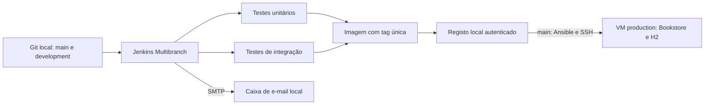

# Jenkins Multibranch — execução e validação locais

Neste tutorial vais executar o Jenkins LTS 2.580.2 em Docker, mantendo a aplicação na VM de produção criada com Vagrant. Vais validar o Jenkinsfile real com duas branches de um repositório Git local, publicar imagens num registo local autenticado e receber notificações SMTP numa caixa Mailpit. Esta fase não exige escrever no GitHub nem publicar novas imagens no Docker Hub.

## 1. Arquitetura do laboratório



O laboratório usa os seguintes serviços:

| Serviço | Endereço | Função |
|---|---|---|
| Jenkins | `http://localhost:18080/` | Multibranch, relatórios e artefactos |
| Mailpit | `http://localhost:18025/` | Consultar os e-mails de teste |
| Registo de imagens | `localhost:15000` | Push e pull com autenticação local |
| VM production | `192.168.56.20:8080` | Bookstore em Docker |

As portas dos serviços Docker ficam ligadas apenas ao loopback do Windows. O registo usa HTTP apenas neste laboratório: a VM acede a `localhost:15000` por um túnel SSH reverso até ao host. Não é necessário alterar as definições globais de registos inseguros do Docker Desktop. No modo Docker Hub, o pipeline usa HTTPS.

## 2. Arrancar

A partir de `CA5/Part2`, executa:

```powershell
.\jenkins\start-local.ps1 -RefreshScm
```

O script garante que a VM está ligada, constrói a imagem Jenkins, prepara segredos locais, cria um snapshot da árvore de trabalho e arranca os serviços com Docker Compose. O Jenkins corre com Java 21; o Gradle e a Bookstore continuam a usar Java 17, disponível em `/opt/java17`.

Abre o Jenkins e entra com o utilizador `luiz`. A palavra-passe gerada fica em `.local/secrets/admin_password`, fora do Git. O conteúdo desse ficheiro nunca deve entrar em comandos publicados, capturas ou evidências.

O bootstrap cria o projeto **ca5-local**, define o caminho `CA5/Part2/Jenkinsfile`, configura as credenciais e o servidor SMTP e inicia a descoberta das branches.

O controlador tem um executor, para que builds de branches diferentes não disputem toda a memória ao mesmo tempo. Dentro de cada build, os dois processos Gradle dos testes correm em paralelo. Só existe um nó Jenkins neste laboratório, pelo que a execução distribuída por vários agentes não é demonstrada; o enunciado condiciona essa demonstração à disponibilidade de vários agentes.

## 3. Distinguir as branches de teste das branches do grupo

O repositório de teste fica em `.local/scm.git`. `prepare-local.py` usa um índice Git independente e cria um commit de snapshot com as fontes locais, incluindo alterações ainda não commitadas. As refs `main` e `development` desse repositório apontam para esse snapshot.

A `main` do repositório do grupo não é alterada. A tua branch de trabalho continua a ser `ca5-part2`. Os commits apresentados nos builds locais são commits do snapshot e estão identificados em `.local/source-manifest.json`; não correspondem a publicações no GitHub.

O Jenkins faz `checkout scm` e obtém o commit da branch realmente descoberta. Não alteras artificialmente `BRANCH_NAME` para testar o deploy. A exceção `ALLOW_LOCAL_CHECKOUT` está limitada à instância Docker deste laboratório e serve para permitir esse repositório local.

Sempre que quiseres testar a árvore de trabalho atual, atualiza o snapshot:

```powershell
py -3 jenkins/prepare-local.py --refresh-scm
```

Depois podes aguardar pelo Poll SCM das branches existentes. Para forçar apenas a descoberta inicial ou uma nova indexação, usa:

```powershell
py -3 jenkins/local-api.py scan
```

## 4. Pipeline

| Stage | Comportamento |
|---|---|
| Checkout | Limpa o workspace, obtém o commit por `checkout scm` e calcula a tag |
| Assemble | Compila e produz o JAR Spring Boot com Java 17 |
| Test | Executa `test` e `integrationTest` em pastas isoladas, publicando os XML JUnit |
| Build and Tag Docker Image | Constrói a imagem do JAR aprovado e identifica-a com branch, build e commit |
| Archive | Arquiva o Dockerfile e `dist/build.json`, com fingerprint |
| Push Docker Image | Autentica por stdin, publica a imagem e arquiva `dist/push.json` |
| Deploy | Executa Ansible apenas quando `when { branch 'main' }` é verdadeiro |

As tags têm a forma `jenkins-main-2-3885c43` ou `jenkins-development-2-3885c43`. A branch evita colisões entre os números dos subjobs Multibranch. O deploy usa essa tag concreta e não `latest`.

### Testes em paralelo e isolamento

O stage Assemble disponibiliza as classes e os recursos de `main`. O `stash` inclui apenas fontes, wrapper e esses resultados de compilação. Não transfere distribuições ou JARs desnecessários para cada ramo de teste.

Os testes unitários usam `.ci/unit/` e os de integração `.ci/integration/`. Cada processo tem a sua pasta `.gradle` de projeto e os seus resultados; apenas a cache de dependências Gradle é partilhada. Os comandos de teste excluem `compileJava` e `processResources`, porque usam a compilação de main produzida e arquivada no stash.

Cada teste escreve um ficheiro de tempos em `app/build/ci/`. O Jenkins arquiva esses ficheiros e os relatórios HTML, além de publicar os resultados JUnit na interface. A [síntese de validação](../evidence/26-local-validation-summary.json) inclui os intervalos observados e confirma a sobreposição temporal dos dois comandos. Não é apresentada como um benchmark de execução sequencial.

Uma falha dos testes marca o build como `UNSTABLE`. `skipStagesAfterUnstable()` impede a construção, publicação e implantação dessa versão. Uma falha de infraestrutura ou da construção Docker marca o build como `FAILURE`.

### Verificação e notificação final

O playbook de deploy confirma a imagem exata, o utilizador sem privilégios, o estado `healthy` e a resposta HTTP `UP`. Depois de um deploy bem-sucedido, a post-action `success` executa novamente `verify.yml` com credencial SSH, sem fornecer credenciais do registo.

A post-action `cleanup` envia a notificação por `emailext`, usando o resultado final. Se a verificação de produção falhar, a notificação reflete a falha. No laboratório, os e-mails são enviados por SMTP para Mailpit e ficam persistidos no volume `mailpit-data`; não são encaminhados para a Internet.

## 5. Configuração e credenciais

| Parâmetro | Valor normal | Ajuste local |
|---|---|---|
| `IMAGE_REPOSITORY` | `luizbsilv/ca5-bookstore` | `localhost:15000/luizbsilv/ca5-bookstore` |
| `REGISTRY_URL` | `https://index.docker.io/v1/` | `http://localhost:15000` |
| `PRODUCTION_HOST` | `192.168.56.20` | `host.docker.internal` |
| `PRODUCTION_SSH_PORT` | `22` | Porta NAT descoberta pelo Vagrant |
| `EMAIL_RECIPIENT` | Configurar o destinatário real | `luiz@ca5.local`, só para captura |

As variáveis `CA5_*` do Compose fornecem os ajustes locais. O Jenkinsfile exige que o modo `CA5_LOCAL_LAB=true` use o registo loopback, evitando uma publicação externa acidental durante estes testes.

| ID no Jenkins Credentials | Tipo | Conteúdo |
|---|---|---|
| `dockerhub-ca5` | Username with password | No laboratório, credencial aleatória do registo local; no Docker Hub, utilizador e access token |
| `ca5-production-ssh` | SSH Username with private key | Utilizador `vagrant` e chave da VM production |
| `github-ca5` | Credencial do repositório | Necessária apenas no futuro job com GitHub como origem |

O bootstrap lê os segredos de ficheiros montados como secrets do Compose e guarda-os no Credentials. A imagem não contém os valores. O push usa uma pasta temporária de autenticação e elimina-a no fim; o Ansible remove a configuração temporária da VM num bloco `always`.

O Jenkins deste laboratório corre como root e usa o socket do Docker Desktop para construir imagens. Esta escolha destina-se ao laboratório local e ao código de confiança do grupo. Os dados e segredos do serviço ficam em volumes ou na pasta ignorada `.local/`, não no repositório.

## 6. Disparo automático e casos demonstrados

O Jenkins não tem um endpoint público. Foi adotado o mecanismo alternativo autorizado pelo enunciado: `pollSCM('H/2 * * * *')`, que verifica alterações aproximadamente a cada dois minutos. O `H` distribui os instantes por job; não significa executar imediatamente após cada alteração.

Os cenários seguintes foram feitos apenas na `development` de `.local/scm.git`. `local-scenario.py` cria commits nessa cópia e não chama o endpoint de build: o Poll SCM deteta-os. As causas `Started by an SCM change` estão nas evidências JSON.

```powershell
py -3 jenkins/local-scenario.py unit-failure
# Aguarda pelo build automático e consulta o resultado.
py -3 jenkins/local-api.py status

py -3 jenkins/local-scenario.py docker-failure
# Aguarda novamente pelo build automático.

py -3 jenkins/local-scenario.py restore
```

Aguarda pela conclusão de cada cenário antes de criar o seguinte. A restauração repõe as fontes corretas nessa cópia, mantendo um histórico local linear.

| Execução observada | Resultado | Evidência principal |
|---|---|---|
| `main #2` | SUCCESS, publicação local, deploy e verificação | [19-jenkins-success-main-2.txt](../evidence/19-jenkins-success-main-2.txt) |
| `development #2` | SUCCESS, publicação local e Deploy ignorado | [20-jenkins-success-development-2.txt](../evidence/20-jenkins-success-development-2.txt) |
| `development #4` | UNSTABLE, teste unitário falhado, publicação bloqueada | [23-jenkins-unstable-email-development-4.txt](../evidence/23-jenkins-unstable-email-development-4.txt) |
| `development #5` | FAILURE no Dockerfile de teste, sem publicação ou deploy | [24-jenkins-docker-failure-development-5.txt](../evidence/24-jenkins-docker-failure-development-5.txt) |
| `development #6` | SUCCESS após restaurar as fontes, sem deploy | [25-jenkins-recovery-development-6.txt](../evidence/25-jenkins-recovery-development-6.txt) |

Os IDs e a imagem do container de produção foram comparados antes e depois dos cenários da development. Mantiveram-se iguais. O registo não recebeu imagens dos builds instáveis ou falhados. A caixa de teste recebeu notificações `SUCCESS`, `UNSTABLE` e `FAILURE`.

## 7. Diagnóstico, evidências e retoma

```powershell
py -3 jenkins/local-api.py lint
py -3 jenkins/local-api.py status
py -3 jenkins/local-api.py logs --branch main
py -3 jenkins/local-api.py export --branch main --number 2 --prefix exemplo
docker compose -f jenkins/compose.yaml logs --tail 60 jenkins registry-tunnel
```

Adapta o número do build ao teu laboratório. O cliente lê a palavra-passe só em memória e mantém a proteção CSRF ativa.

Para parar os serviços preservando os dados:

```powershell
docker compose -f jenkins/compose.yaml stop
vagrant halt production
```

Para retomar, usa novamente `start-local.ps1`. Evita `down --volumes` se quiseres preservar builds, imagens e e-mails. A H2 da Bookstore é em memória, pelo que o estado dos dados da aplicação não sobrevive a uma substituição do container.

## 8. Passagem posterior para GitHub e Docker Hub

Esta fase fica deliberadamente para depois da validação local:

1. Publicar os commits da branch de trabalho e preparar a integração do Jenkinsfile nas branches `main` e `development` do grupo.
2. Criar uma credencial de leitura do repositório privado no Jenkins.
3. Criar um segundo projeto Multibranch, com GitHub Branch Source, filtrando `main` e `development` e usando `CA5/Part2/Jenkinsfile`.
4. Não usar as variáveis `CA5_*` específicas do registo local nesse projeto. Se partilhares esta instância, remove os ajustes locais antes de ativar o job externo ou usa uma instância separada.
5. Guardar o access token Docker Hub na credencial `dockerhub-ca5`, numa pasta de credenciais própria do job externo, e definir o repositório de imagem real.
6. Configurar SMTP real no Email Extension, com credencial de envio e destinatário, para entregar notificações fora do Mailpit.
7. Demonstrar o Poll SCM a partir de pushes reais nas duas branches e arquivar essas evidências finais.
8. Fazer a revisão final e marcar o commit com `ca5-part2`.

Os testes locais demonstram o funcionamento do Jenkinsfile, das condições por branch, do Ansible, do registo e do SMTP. A receção de eventos do GitHub e a execução do mesmo pipeline contra o Docker Hub ainda exigem essa demonstração após a publicação.

## 9. Referências

- [Jenkins em Docker](https://www.jenkins.io/doc/book/installing/docker/)
- [Sintaxe declarativa e condições por branch](https://www.jenkins.io/doc/book/pipeline/syntax/)
- [Multibranch Pipeline](https://www.jenkins.io/doc/book/pipeline/multibranch/)
- [Email Extension](https://plugins.jenkins.io/email-ext/)
- [Mailpit SMTP](https://mailpit.axllent.org/docs/configuration/smtp/)
- [Configuração do registo Distribution](https://distribution.github.io/distribution/about/configuration/)
