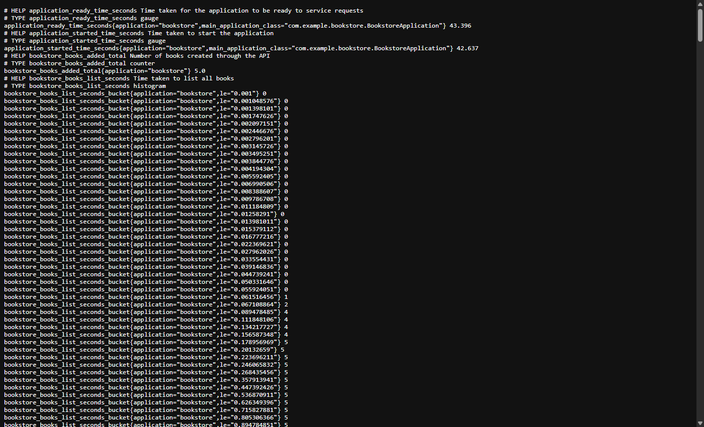
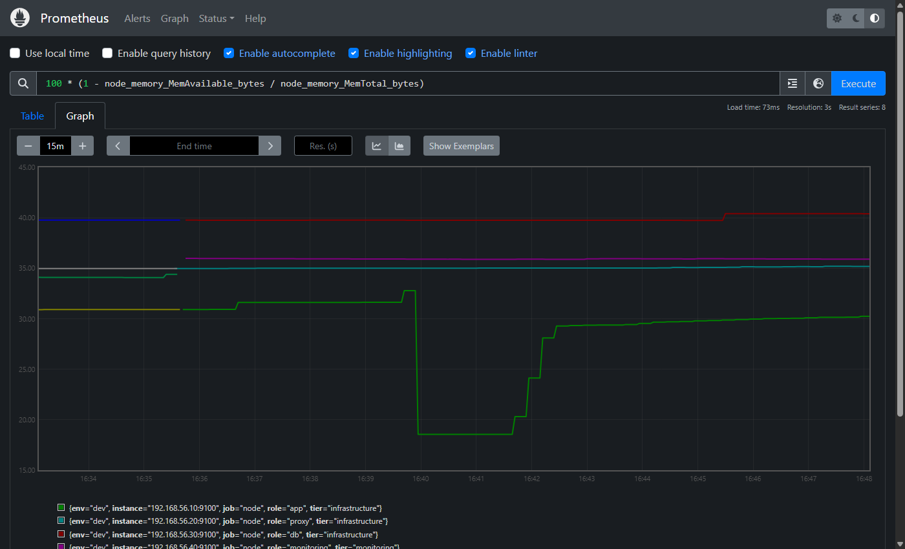
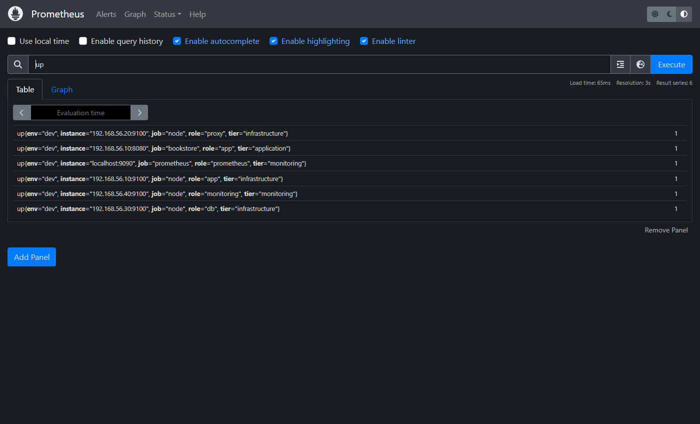
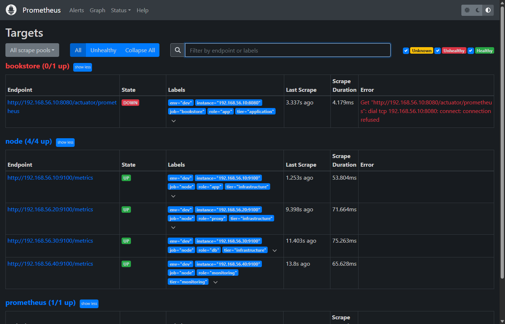
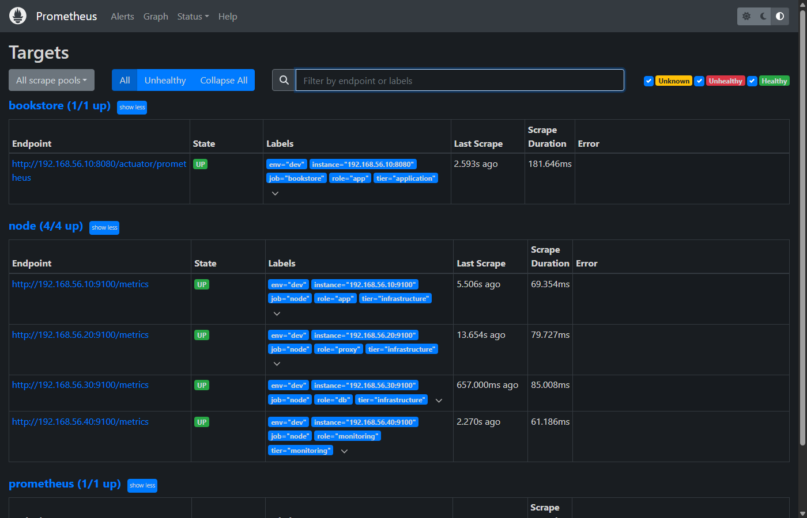
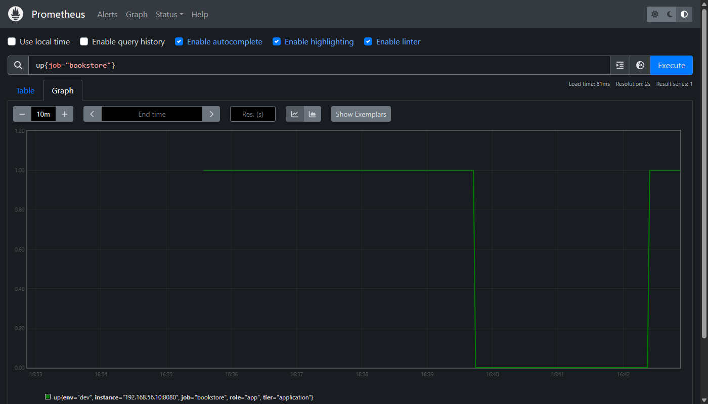

# CA6 – Parte 1: Observabilidade com Prometheus

Monitorização da Bookstore (Spring Boot) com Prometheus, Node Exporter e Micrometer. A app, a base de dados e o reverse proxy correm em VMs separadas, como no CA2 Parte 2. O Prometheus corre numa quarta VM dedicada.

Issue: #24

## Arquitetura

| VM | IP | Serviços | Portas |
|---|---|---|---|
| app | 192.168.56.10 | `bookstore`, `node_exporter` | 8080, 9100 |
| proxy | 192.168.56.20 | `nginx`, `node_exporter` | 80 (host: 8081), 9100 |
| db | 192.168.56.30 | `h2-server`, `node_exporter` | 9092, 9100 |
| monitoring | 192.168.56.40 | `prometheus`, `node_exporter` | 9090 (host: 9090), 9100 |

```
CA6/
├── Vagrantfile
├── bookstore/                      # código da app (cópia do CA1/week2)
├── monitoring/prometheus/prometheus.yml
└── provision/
    ├── common.sh                   # node_exporter, corre em todas as VMs
    ├── db.sh
    ├── app.sh
    ├── proxy.sh
    └── prometheus.sh
```

## Deployment

```bash
cd CA6
vagrant up
```

A raiz do repositório é montada em `/vagrant` em todas as VMs. A app é compilada a partir de `/vagrant/CA6/bookstore`, por isso alterações ao código entram com `vagrant provision app`, sem precisar de push.

Verificação rápida:

```bash
curl http://localhost:8081/books                          # app via proxy
curl http://192.168.56.10:9100/metrics | head             # node_exporter
curl http://192.168.56.10:8080/actuator/prometheus | grep bookstore
```

## Node Exporter

O `provision/common.sh` é declarado como provisioner global no `Vagrantfile`, por isso corre em todas as VMs antes do script específico de cada uma. Instala o binário (versão fixada em `NODE_EXPORTER_VERSION`) e cria o serviço systemd `node_exporter` na porta 9100.

A VM `db` tem `ufw` ativo desde o CA2. Foi acrescentada uma regra que só permite a porta 9100 a partir do IP do Prometheus, para a monitorização não expor a base de dados.

## Prometheus

O `provision/prometheus.sh` instala o Prometheus (versão fixada em `PROMETHEUS_VERSION`) e o `promtool`, e cria o serviço systemd com `--web.enable-lifecycle`.

A configuração vive no repositório, em `monitoring/prometheus/prometheus.yml`, e `/etc/prometheus/prometheus.yml` é um symlink para esse ficheiro. Uma alteração à config fica versionada e aplica-se sem reprovisionar:

```bash
vagrant ssh monitoring -c "promtool check config /etc/prometheus/prometheus.yml"
vagrant ssh monitoring -c "curl -X POST localhost:9090/-/reload"
```

O provisioning corre o `promtool check config` antes de arrancar o serviço, para uma config inválida fazer falhar o `vagrant up` em vez de deixar o Prometheus parado.


## Instrumentação da app

Dependências adicionadas: `spring-boot-starter-actuator` (já existia) e `micrometer-registry-prometheus`. No `application.properties`:

```properties
management.endpoints.web.exposure.include=health,info,metrics,prometheus
management.metrics.tags.application=bookstore
management.metrics.distribution.percentiles-histogram.http.server.requests=true
```

A tag comum `application=bookstore` é aplicada a todas as métricas da app. O histograma de `http.server.requests` permite calcular percentis de latência no Prometheus.

As métricas próprias estão em `BookService`, uma camada de serviço criada entre o `BookController` e o repositório:

| Métrica (Prometheus) | Tipo | Significado |
|---|---|---|
| `bookstore_books_added_total` | Counter | livros criados via `POST /books` |
| `bookstore_books_list_seconds` | Timer | duração de `GET /books` (com histograma) |
| `bookstore_books_stored` | Gauge | `count()` da tabela de livros, lido a cada scrape |

O Gauge consulta a base de dados em vez de manter um contador em memória. Assim reflete também livros inseridos fora da API (por exemplo pelo `DataInitializer`) e não perde o valor quando a app reinicia.

Os nomes `bookstore.books.created` e `bookstore.books.total` foram descartados: o cliente Prometheus remove os sufixos `_created` e `_total`, reservados no formato OpenMetrics, e as duas métricas acabavam com o mesmo nome.



## Jobs e labels

| job | target | tier | role | intervalo |
|---|---|---|---|---|
| prometheus | localhost:9090 | monitoring | prometheus | 15s |
| node | 192.168.56.10:9100 | infrastructure | app | 15s |
| node | 192.168.56.20:9100 | infrastructure | proxy | 15s |
| node | 192.168.56.30:9100 | infrastructure | db | 15s |
| node | 192.168.56.40:9100 | monitoring | monitoring | 15s |
| bookstore | 192.168.56.10:8080 | application | app | 10s |

Todos os targets têm `env=dev`. O `job` separa a origem das métricas (sistema operativo, JVM/app, Prometheus) e o `tier` separa aplicação de infraestrutura. A VM `app` aparece com os dois tiers: `role="app"` junta a vista da máquina e a vista da aplicação.

## Queries PromQL

### Gerar tráfego

Para os gráficos terem dados, gerar pedidos através do proxy durante alguns minutos (PowerShell):

```powershell
while ($true) { curl.exe -s http://localhost:8081/books > $null; curl.exe -s http://localhost:8081/books/1 > $null; Start-Sleep -Milliseconds 200 }
```

E criar alguns livros para o Counter:

```powershell
1..5 | % { curl.exe -s -X POST -H "Content-Type: application/json" -d '{\"title\":\"Livro\",\"author\":\"Autor\",\"price\":10}' http://localhost:8081/books }
```

As queries foram executadas em `http://localhost:9090/graph`, separador Graph, com janela de 15 minutos.

### Infraestrutura

| Objetivo | Query |
|---|---|
| CPU % por VM | `100 * (1 - avg by (role) (rate(node_cpu_seconds_total{mode="idle"}[1m])))` |
| Memória % por VM | `100 * (1 - node_memory_MemAvailable_bytes / node_memory_MemTotal_bytes)` |
| Disco livre % | `100 * node_filesystem_avail_bytes{mountpoint="/"} / node_filesystem_size_bytes{mountpoint="/"}` |

O CPU é calculado a partir do tempo em `idle`, porque `node_cpu_seconds_total` é um contador por core e por modo: `rate` dá a fração de tempo por segundo e `avg by (role)` junta os cores de cada VM. Para a memória usa-se `MemAvailable` em vez de `MemFree`, porque inclui a cache que o kernel liberta quando é preciso.




### JVM e HTTP

| Objetivo | Query |
|---|---|
| Heap usado (MB) | `sum(jvm_memory_used_bytes{job="bookstore",area="heap"}) / 1024 / 1024` |
| Heap % do máximo | `100 * sum(jvm_memory_used_bytes{job="bookstore",area="heap"}) / sum(jvm_memory_max_bytes{job="bookstore",area="heap"} > 0)` |
| Pedidos/s | `sum(rate(http_server_requests_seconds_count{job="bookstore",uri!~"/actuator.*"}[1m]))` |
| Pedidos/s por endpoint | `sum by (uri) (rate(http_server_requests_seconds_count{job="bookstore",uri!~"/actuator.*"}[1m]))` |
| Latência média (s) | `sum(rate(http_server_requests_seconds_sum{job="bookstore",uri!~"/actuator.*"}[1m])) / sum(rate(http_server_requests_seconds_count{job="bookstore",uri!~"/actuator.*"}[1m]))` |
| Latência p95 (s) | `histogram_quantile(0.95, sum by (le) (rate(http_server_requests_seconds_bucket{job="bookstore",uri!~"/actuator.*"}[5m])))` |

Os pedidos a `/actuator` são excluídos porque o próprio scrape do Prometheus os gera a cada 10s. No heap, o filtro `> 0` é necessário porque os pools Eden e Survivor do G1 reportam máximo `-1` (sem limite próprio).


### Métricas próprias

| Objetivo | Query |
|---|---|
| Livros criados na última hora | `increase(bookstore_books_added_total[1h])` |
| Duração média da listagem (s) | `rate(bookstore_books_list_seconds_sum[5m]) / rate(bookstore_books_list_seconds_count[5m])` |
| Livros na BD | `bookstore_books_stored` |


### Disponibilidade

| Objetivo | Query |
|---|---|
| Estado de todos os targets | `up` |
| Targets em baixo | `up == 0` |
| Disponibilidade da app (%) na última hora | `100 * avg_over_time(up{job="bookstore"}[1h])` |
| Estado por tier | `min by (tier) (up)` |



## Simulação de falha

Objetivo: confirmar que o Prometheus deteta a indisponibilidade da app e a recuperação, sem intervenção manual na configuração.

1. Estado inicial, com todos os targets UP:

   

2. Parar a app:

   ```bash
   vagrant ssh app -c "sudo systemctl stop bookstore"
   ```

   Como o job `bookstore` faz scrape a cada 10s, o target passa a DOWN no scrape seguinte, com erro de ligação recusada na porta 8080. Os targets `node` da mesma VM continuam UP: a máquina está saudável e só a aplicação falhou. É esta a distinção que as labels `tier=application` e `tier=infrastructure` tornam visível.

   

3. Voltar a iniciar a app:

   ```bash
   vagrant ssh app -c "sudo systemctl start bookstore"
   ```

   O target volta a UP depois de o Spring Boot arrancar e responder em `/actuator/prometheus`.

   

Evolução de `up{job="bookstore"}` durante o teste, no separador Graph:



Durante a falha, `bookstore_books_stored` e as restantes métricas da app deixam de ter amostras, em vez de passarem a zero. Por isso a disponibilidade deve ser medida com `up` e não com a ausência de valores de outras métricas.

O efeito também é visível nos gráficos da secção PromQL: o heap da JVM fica sem amostras entre as 16:39 e as 16:42, e a memória usada na VM `app` desce de cerca de 32% para 19% enquanto a JVM está parada.
