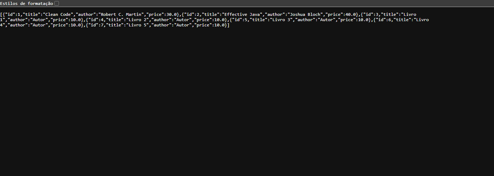
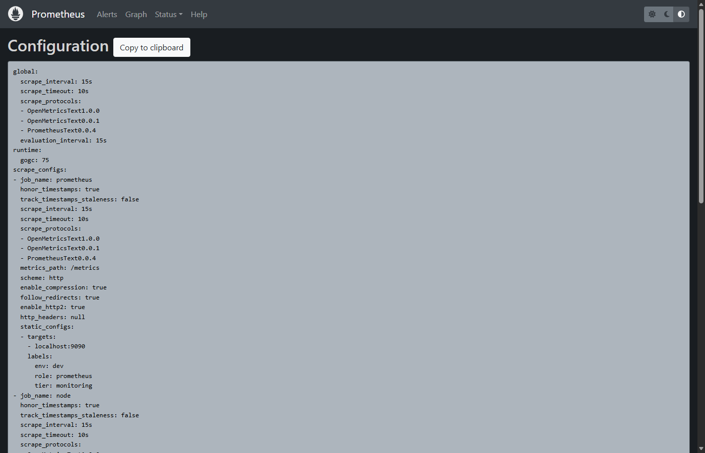
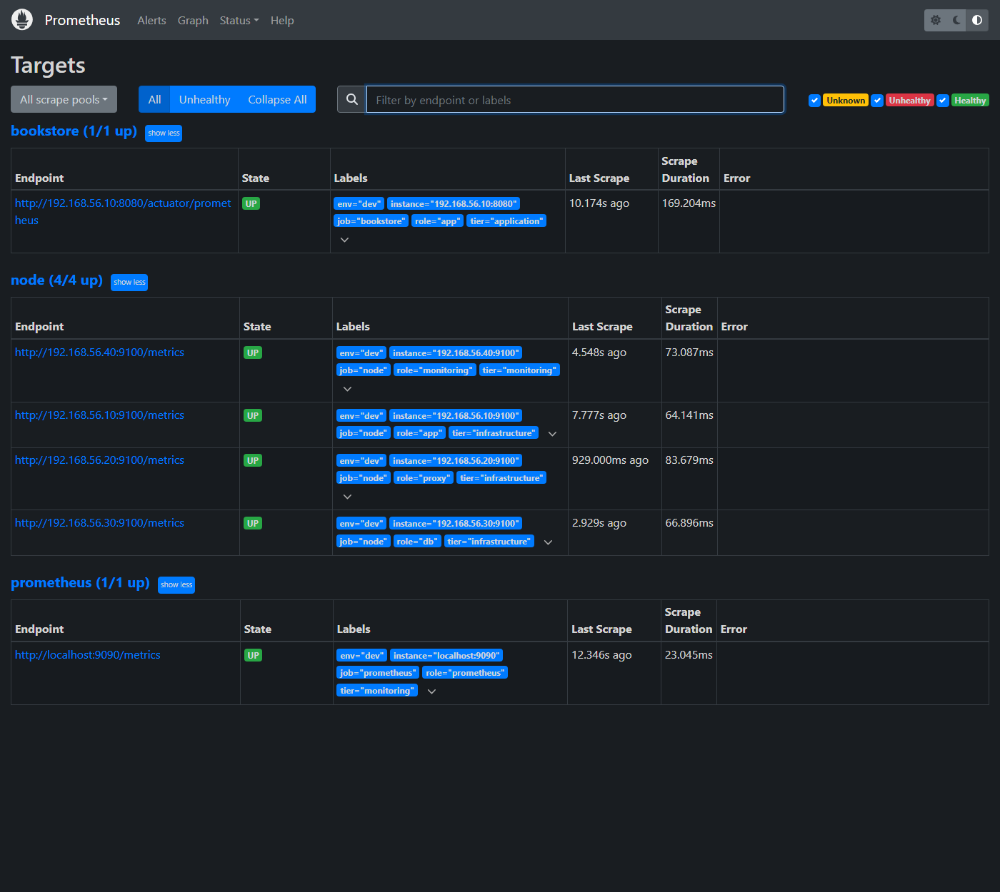
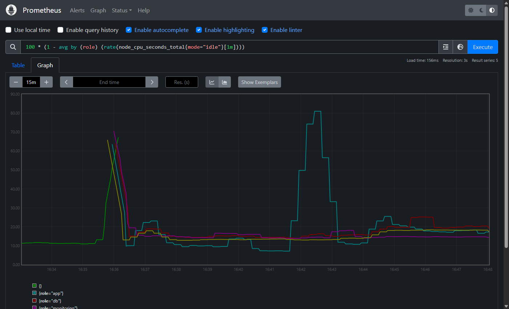
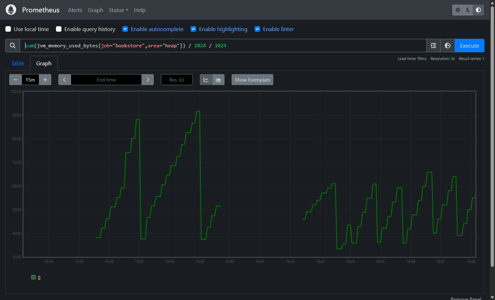
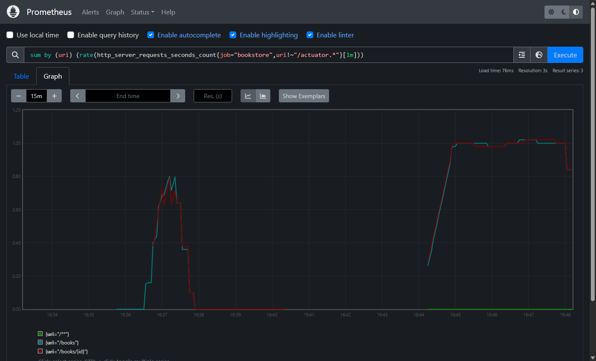
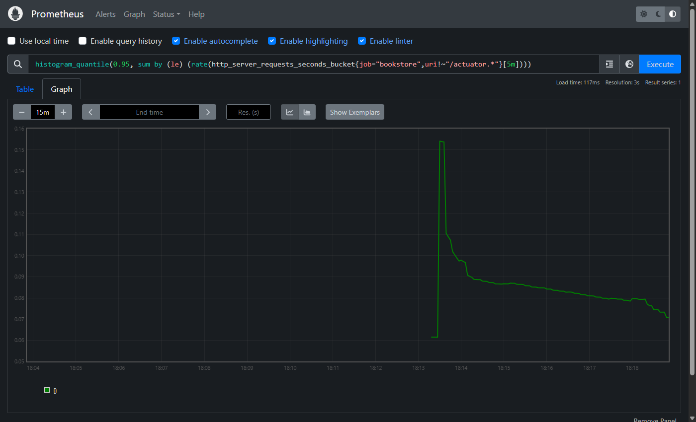
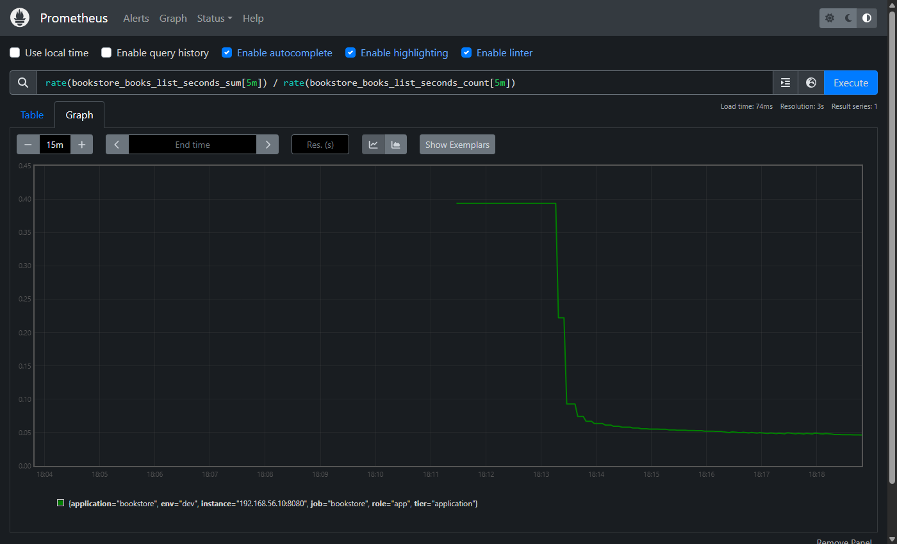
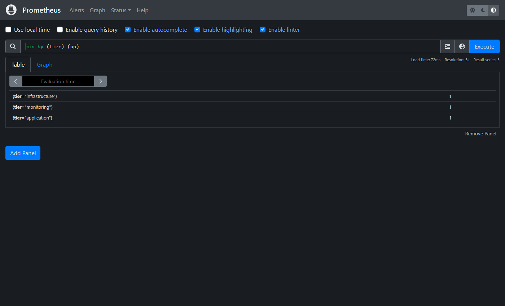

# CA6 – Parte 1: Observabilidade com Prometheus

Plataforma de monitorização para a Bookstore (Spring Boot), construída segundo princípios de Observability-as-Code. A app, a base de dados e o reverse proxy correm em VMs separadas, como no CA2 Parte 2, e um Prometheus numa quarta VM dedicada recolhe métricas de infraestrutura (Node Exporter) e da aplicação (Actuator + Micrometer).

Issue: #24 · Branch: `ca6-part1` · Tag: `ca6-part1`

## Índice

1. [Análise e desenho](#1-análise-e-desenho)
2. [Pré-requisitos e deployment](#2-pré-requisitos-e-deployment)
3. [Etapa 1 – Ambiente base (app, db, proxy)](#3-etapa-1--ambiente-base-app-db-proxy)
4. [Etapa 2 – Node Exporter em todas as VMs](#4-etapa-2--node-exporter-em-todas-as-vms)
5. [Etapa 3 – Prometheus numa VM dedicada](#5-etapa-3--prometheus-numa-vm-dedicada)
6. [Etapa 4 – Instrumentação da app com Micrometer](#6-etapa-4--instrumentação-da-app-com-micrometer)
7. [Etapa 5 – Jobs e labels](#7-etapa-5--jobs-e-labels)
8. [Etapa 6 – Análise com PromQL](#8-etapa-6--análise-com-promql)
9. [Etapa 7 – Simulação de falha](#9-etapa-7--simulação-de-falha)
10. [Etapa 8 – Verificação da reprodutibilidade](#10-etapa-8--verificação-da-reprodutibilidade)
11. [Justificação das decisões](#11-justificação-das-decisões)
12. [Problemas encontrados](#12-problemas-encontrados)
13. [Autoavaliação](#13-autoavaliação)

## 1. Análise e desenho

### Requisitos da Parte 1

| Requisito | Onde é tratado |
|---|---|
| App, BD e proxy em VMs separadas, deployment reproduzível | Etapa 1, Etapa 8 |
| Prometheus dedicado, configuração como código | Etapa 3 |
| Node Exporter em todas as VMs | Etapa 2 |
| Métricas próprias com Micrometer em `/actuator/prometheus` | Etapa 4 |
| Labels que distinguem aplicação de infraestrutura | Etapa 5 |
| PromQL para CPU, memória, JVM e disponibilidade, com resultados | Etapa 6 |
| Falha com evidência UP → DOWN → UP | Etapa 7 |

### Arquitetura

```
                        host (Windows)
              localhost:8081        localhost:9090
                    │                     │
  ──────────────────┼─────────────────────┼──────────── 192.168.56.0/24
                    │                     │
             ┌──────▼──────┐       ┌──────▼──────┐
             │   proxy .20 │       │monitoring.40│
             │   nginx :80 │       │ prometheus  │──── scrape ────┐
             │  node :9100 │       │  node :9100 │                │
             └──────┬──────┘       └─────────────┘                │
                    │ :8080                                       │
             ┌──────▼──────┐       ┌─────────────┐                │
             │    app .10  │──────►│    db .30   │                │
             │ bookstore   │ :9092 │  H2 (TCP)   │                │
             │  node :9100 │       │  node :9100 │                │
             └─────────────┘       └─────────────┘                │
                    ▲                     ▲                       │
                    └──── :8080 /actuator/prometheus, :9100 ──────┘
```

| VM | IP | Serviços (systemd) | Portas | RAM |
|---|---|---|---|---|
| app | 192.168.56.10 | `bookstore`, `node_exporter` | 8080, 9100 | 2048 MB |
| proxy | 192.168.56.20 | `nginx`, `node_exporter` | 80 (host 8081), 9100 | 512 MB |
| db | 192.168.56.30 | `h2-server`, `node_exporter` | 9092, 9100 | 1024 MB |
| monitoring | 192.168.56.40 | `prometheus`, `node_exporter` | 9090 (host 9090), 9100 | 1024 MB |

Os IPs da app, do proxy e da BD são os do CA2 Parte 2. O IP sugerido para o Prometheus (`.20`) já era o do proxy, por isso a VM `monitoring` ficou com `.40`.

O modelo é *pull*: o Prometheus vai buscar as métricas a cada target. Nenhuma VM precisa de saber que está a ser monitorizada, e um target que deixa de responder é detetado pelo próprio scrape (Etapa 7).

### Estrutura do repositório

```
CA6/
├── Vagrantfile                         # 4 VMs, IPs em constantes
├── bookstore/                          # app (cópia do CA1/week2, sem .git)
├── monitoring/prometheus/prometheus.yml
├── provision/
│   ├── common.sh                       # node_exporter (todas as VMs)
│   ├── db.sh                           # H2 + ufw
│   ├── app.sh                          # build + serviço bookstore
│   ├── proxy.sh                        # nginx
│   └── prometheus.sh                   # prometheus + promtool
└── images/
```

Tudo o que define a monitorização (versões, serviços, scrape config, labels) está em ficheiros versionados. Não há passos manuais na interface do Prometheus.

## 2. Pré-requisitos e deployment

Versões usadas e testadas:

| Ferramenta | Versão |
|---|---|
| VirtualBox | 7.2.18 |
| Vagrant | 2.4.9 |
| Box | `ubuntu/jammy64` 20241002.0.0 |
| Prometheus | 2.53.2 |
| Node Exporter | 1.8.2 |
| Spring Boot | 3.3.0 (Java 17) |

As portas 8081 e 9090 do host têm de estar livres. São precisos cerca de 4,5 GB de RAM livres para as quatro VMs.

```bash
git clone <repo> && cd <repo>/CA6
vagrant up
```

No fim, a app responde em `http://localhost:8081/books` e o Prometheus em `http://localhost:9090`. O `Vagrantfile` monta a raiz do repositório em `/vagrant` em todas as VMs, para os scripts poderem usar caminhos como `/vagrant/CA6/monitoring/...`.

## 3. Etapa 1 – Ambiente base (app, db, proxy)

**Objetivo.** Reproduzir o ambiente do CA2 Parte 2 dentro da pasta `CA6/`, para ter uma aplicação real e multi-serviço para monitorizar.

**O que foi feito.**

1. A Bookstore foi copiada de `CA1/week2` para `CA6/bookstore/`, apenas com os ficheiros versionados (sem `.git`, sem `build/`). A variante Maven ficou de fora, porque o build usa Gradle.
2. O `Vagrantfile` e os scripts de provisioning foram trazidos do CA2 e simplificados. Os IPs ficam em constantes no topo do `Vagrantfile` e são passados aos scripts como variáveis de ambiente, para cada IP estar escrito num só sítio:

   ```ruby
   APP_IP   = "192.168.56.10"
   PROXY_IP = "192.168.56.20"
   DB_IP    = "192.168.56.30"
   MONITORING_IP = "192.168.56.40"
   ...
   db.vm.provision "shell", path: "provision/db.sh",
     env: { "APP_IP" => APP_IP, "MONITORING_IP" => MONITORING_IP }
   ```

3. `db.sh` instala o H2 2.2.224 em modo TCP como serviço `h2-server` e ativa o `ufw`, permitindo a porta 9092 apenas a partir da app.
4. `app.sh` copia o código de `/vagrant/CA6/bookstore` para `/opt/bookstore/src`, compila com `./gradlew :app:bootJar` e cria o serviço `bookstore`. O serviço espera que a porta 9092 da BD esteja aberta antes de arrancar (`ExecStartPre`).
5. `proxy.sh` instala o Nginx como reverse proxy para `APP_IP:8080`.

**Porquê.**

- **Build a partir da pasta partilhada, não de um `git clone`.** O CA2 clonava o repositório do GitHub, por isso só via o que já estava na `main`. Aqui, uma alteração ao código entra com `vagrant provision app`, sem push. A compilação é feita numa cópia (`/opt/bookstore/src`) para não deixar `build/` e `.gradle/` no host.
- **`.gitattributes` com `eol=lf` para os `.sh`.** Num clone em Windows, os scripts ficariam com CRLF e o `bash` falharia dentro das VMs.
- **Porta 8081 no host.** A porta 80 no Windows exige privilégios ou já está ocupada.

**Verificação.**

```
$ curl http://localhost:8081/books
[{"id":1,"title":"Clean Code","author":"Robert C. Martin","price":30.0},{"id":2,"title":"Effective Java","author":"Joshua Bloch","price":40.0}]
```



## 4. Etapa 2 – Node Exporter em todas as VMs

**Objetivo.** Cada VM expõe métricas do sistema operativo (CPU, memória, disco, rede) na porta 9100.

**O que foi feito.**

1. `provision/common.sh` descarrega o Node Exporter (versão fixada em `NODE_EXPORTER_VERSION="1.8.2"`), cria um utilizador de sistema sem shell e o serviço systemd `node_exporter`. Só volta a descarregar o binário se a versão instalada for diferente, por isso pode correr várias vezes.
2. No `Vagrantfile`, o script é declarado ao nível de `config` e não dentro de cada VM:

   ```ruby
   config.vm.provision "common", type: "shell", path: "provision/common.sh"
   ```

   Um provisioner global corre em todas as VMs antes dos específicos. A VM `monitoring`, adicionada na Etapa 3, ficou com Node Exporter sem mais alterações.
3. Em `db.sh` foi acrescentada uma regra de firewall:

   ```bash
   ufw allow from "$MONITORING_IP" to any port 9100 proto tcp
   ```

**Porquê.** O Node Exporter corre como utilizador sem privilégios porque só lê `/proc` e `/sys`. A regra na BD limita a porta 9100 ao Prometheus: a monitorização não deve abrir a VM mais sensível ao resto da rede.

**Verificação.** Cada VM responde e identifica-se pelo hostname (`node_uname_info`). A BD foi testada a partir de dentro, porque a firewall bloqueia o host, que é o comportamento pretendido:

```
$ curl -s 192.168.56.10:9100/metrics | grep ^node_uname_info
node_uname_info{...,nodename="cogsi-ca6-app",release="5.15.0-198-generic",...} 1
$ curl -s 192.168.56.20:9100/metrics | grep ^node_uname_info
node_uname_info{...,nodename="cogsi-ca6-proxy",...} 1
$ curl -s 192.168.56.40:9100/metrics | grep ^node_uname_info
node_uname_info{...,nodename="cogsi-ca6-monitoring",...} 1

$ vagrant ssh db -c "curl -s localhost:9100/metrics | grep ^node_uname_info; sudo ufw status | grep -E '9092|9100'"
node_uname_info{...,nodename="cogsi-ca6-db",...} 1
9092/tcp                   ALLOW       192.168.56.10
9100/tcp                   ALLOW       192.168.56.40
```

## 5. Etapa 3 – Prometheus numa VM dedicada

**Objetivo.** Um servidor Prometheus cuja instalação e configuração estejam inteiramente no repositório.

**O que foi feito.**

1. Nova VM `monitoring` (192.168.56.40, 1 GB RAM) com a porta 9090 reencaminhada para o host.
2. `provision/prometheus.sh`:
   - descarrega o Prometheus (versão em `PROMETHEUS_VERSION="2.53.2"`) e instala `prometheus` e `promtool`;
   - cria o symlink `/etc/prometheus/prometheus.yml` → `/vagrant/CA6/monitoring/prometheus/prometheus.yml`;
   - corre `promtool check config` e só depois arranca o serviço;
   - cria o serviço systemd com retenção de 15 dias, `ExecReload` por `SIGHUP` e `--web.enable-lifecycle`.
3. A primeira versão do `prometheus.yml` tinha só o job `prometheus` (o próprio servidor). O job `node`, com as 4 VMs, entrou num commit separado.

**Porquê.**

- **Symlink para o ficheiro do repositório.** O ficheiro que o Prometheus lê é o ficheiro versionado, não uma cópia. Não há forma de a configuração em execução divergir da que está no Git.
- **`promtool check config` no provisioning.** Com `set -e`, uma config inválida faz falhar o `vagrant up` com uma mensagem clara, em vez de deixar o serviço parado.
- **`--web.enable-lifecycle`.** Permite aplicar alterações sem reiniciar o processo e sem perder o estado em memória:

  ```bash
  vagrant ssh monitoring -c "promtool check config /etc/prometheus/prometheus.yml && curl -X POST localhost:9090/-/reload"
  ```

**Verificação.**

```
$ vagrant ssh monitoring -c "promtool check config /etc/prometheus/prometheus.yml; ls -l /etc/prometheus/prometheus.yml"
Checking /etc/prometheus/prometheus.yml
 SUCCESS: /etc/prometheus/prometheus.yml is valid prometheus config file syntax

lrwxrwxrwx 1 root root 49 Nov 24 18:10 /etc/prometheus/prometheus.yml -> /vagrant/CA6/monitoring/prometheus/prometheus.yml
```

A configuração carregada, vista em Status → Configuration, é a do repositório:



## 6. Etapa 4 – Instrumentação da app com Micrometer

**Objetivo.** Expor, além das métricas automáticas do Actuator (JVM, HTTP, Tomcat, HikariCP), métricas próprias do domínio da Bookstore.

**O que foi feito.**

1. Dependências (`gradle/libs.versions.toml` e `app/build.gradle`). O Actuator já existia; foi adicionado o registry Prometheus:

   ```groovy
   implementation libs.spring.boot.starter.actuator
   runtimeOnly libs.micrometer.registry.prometheus
   ```

2. `application.properties`:

   ```properties
   management.endpoints.web.exposure.include=health,info,metrics,prometheus
   management.metrics.tags.application=bookstore
   management.metrics.distribution.percentiles-histogram.http.server.requests=true
   ```

   A tag comum acrescenta `application="bookstore"` a todas as séries da app. O histograma de `http.server.requests` publica buckets, necessários para calcular percentis no Prometheus.

3. O projeto não tinha camada de serviço: o `BookController` chamava o repositório diretamente. Foi criado `service/BookService.java`, e o controller passou a usá-lo. Os endpoints não mudaram.

   ```java
   this.booksAdded = Counter.builder("bookstore.books.added")
           .description("Number of books created through the API")
           .register(registry);
   this.listTimer = Timer.builder("bookstore.books.list")
           .description("Time taken to list all books")
           .publishPercentileHistogram()
           .register(registry);
   Gauge.builder("bookstore.books.stored", repo, BookRepository::count)
           .description("Total number of books in the database")
           .register(registry);
   ```

| Métrica no Prometheus | Tipo | O que mede |
|---|---|---|
| `bookstore_books_added_total` | Counter | livros criados via `POST /books` |
| `bookstore_books_list_seconds` | Timer (histograma) | duração de `GET /books` |
| `bookstore_books_stored` | Gauge | número de livros na BD, lido a cada scrape |

**Porquê.**

- **Os três tipos de métrica.** O Counter responde a "quantas vezes aconteceu" e só cresce. O Timer responde a "quanto tempo demora". O Gauge responde a "qual é o valor agora".
- **As métricas no service, não no controller.** O service é onde está a operação de negócio. Se outro ponto de entrada criar livros, a métrica continua certa.
- **Gauge sobre `count()` e não sobre um contador em memória.** Reflete também livros inseridos fora da API (pelo `DataInitializer`, por exemplo) e não perde o valor quando a app reinicia. O custo é uma query `count()` a cada 10s.

**Verificação**, depois de 5 `POST` e cerca de 5 minutos de tráfego:

```
$ curl -s 192.168.56.10:8080/actuator/prometheus | grep -E '^bookstore_books_(added_total|stored|list_seconds_(count|sum|max))'
bookstore_books_added_total{application="bookstore"} 5.0
bookstore_books_list_seconds_count{application="bookstore"} 309
bookstore_books_list_seconds_sum{application="bookstore"} 15.057600424
bookstore_books_list_seconds_max{application="bookstore"} 0.155528334
bookstore_books_stored{application="bookstore"} 7.0
```


## 7. Etapa 5 – Jobs e labels

**Objetivo.** Recolher as métricas da app e organizar todos os targets de forma a distinguir aplicação de infraestrutura.

**O que foi feito.** O `prometheus.yml` final tem três jobs, e cada target tem três labels:

```yaml
global:
  scrape_interval: 15s
  evaluation_interval: 15s

scrape_configs:
  - job_name: prometheus
    static_configs:
      - targets: ["localhost:9090"]
        labels: { tier: monitoring, role: prometheus, env: dev }

  - job_name: node
    static_configs:
      - targets: ["192.168.56.10:9100"]
        labels: { tier: infrastructure, role: app, env: dev }
      # proxy (.20), db (.30) -> tier: infrastructure
      # monitoring (.40)      -> tier: monitoring

  - job_name: bookstore
    metrics_path: /actuator/prometheus
    scrape_interval: 10s
    static_configs:
      - targets: ["192.168.56.10:8080"]
        labels: { tier: application, role: app, env: dev }
```

(Excerto. O ficheiro completo está em `monitoring/prometheus/prometheus.yml`.)

| job | target | tier | role | intervalo |
|---|---|---|---|---|
| prometheus | localhost:9090 | monitoring | prometheus | 15s |
| node | 192.168.56.10:9100 | infrastructure | app | 15s |
| node | 192.168.56.20:9100 | infrastructure | proxy | 15s |
| node | 192.168.56.30:9100 | infrastructure | db | 15s |
| node | 192.168.56.40:9100 | monitoring | monitoring | 15s |
| bookstore | 192.168.56.10:8080 | application | app | 10s |

**Porquê.**

- **`tier`** é a label pedida no enunciado: separa `application` de `infrastructure`. Foi acrescentado um terceiro valor, `monitoring`, para que uma falha do próprio sistema de monitorização não seja confundida com uma falha da infraestrutura que serve a aplicação.
- **`role`** identifica a função da máquina. A VM `app` aparece duas vezes: com `tier=infrastructure` (a máquina) e `tier=application` (a JVM). `{role="app"}` junta as duas vistas, o que permite distinguir "a máquina está mal" de "a app está mal" (Etapa 7).
- **`env`** não varia hoje (só existe `dev`), mas as queries e os futuros dashboards da Parte 2 podem filtrar por ambiente sem mudar quando houver um segundo.
- **As labels ficam na configuração do Prometheus e não na app.** Classificar targets é uma decisão de quem opera a monitorização. A app só sabe o seu nome (`application`).

**Verificação.** Os 6 targets UP, com as labels aplicadas:



## 8. Etapa 6 – Análise com PromQL

**Objetivo.** Identificar métricas representativas de CPU, memória, JVM/aplicação e disponibilidade, e analisar os resultados.

**Como reproduzir.** Gerar carga através do proxy durante 5 minutos e criar alguns livros (PowerShell):

```powershell
1..5 | % { curl.exe -s -X POST -H "Content-Type: application/json" -d '{\"title\":\"Livro\",\"author\":\"Autor\",\"price\":10}' http://localhost:8081/books }
```

```powershell
$end = (Get-Date).AddMinutes(5); while ((Get-Date) -lt $end) { curl.exe -s http://localhost:8081/books > $null; curl.exe -s http://localhost:8081/books/1 > $null; Start-Sleep -Milliseconds 200 }
```

As queries foram corridas em `http://localhost:9090/graph`, separador Graph, numa janela de 15 minutos. Os valores na coluna "Resultado" foram medidos no fim desse período, no ambiente reconstruído de raiz (Etapa 8).

### Infraestrutura (Node Exporter)

| Objetivo | Query | Resultado |
|---|---|---|
| CPU % por VM | `100 * (1 - avg by (role) (rate(node_cpu_seconds_total{mode="idle"}[1m])))` | app 16,8% · proxy 18,0% · db 18,9% · monitoring 14,3% |
| Memória % por VM | `100 * (1 - node_memory_MemAvailable_bytes / node_memory_MemTotal_bytes)` | app 34,8% · proxy 34,8% · db 38,9% · monitoring 36,0% |
| Disco livre % | `100 * node_filesystem_avail_bytes{mountpoint="/"} / node_filesystem_size_bytes{mountpoint="/"}` | entre 93,2% (app) e 95,1% (proxy) |

- **CPU.** `node_cpu_seconds_total` é um contador por core e por modo. `rate(...[1m])` dá a fração de tempo por segundo em cada modo, e `avg by (role)` junta os cores da VM. Usa-se o complemento de `idle` em vez de somar todos os modos, porque assim ficam incluídos `user`, `system`, `iowait`, `steal`, etc.
- **Memória.** Usa-se `MemAvailable` e não `MemFree`, porque inclui a page cache que o kernel liberta quando é preciso. Com `MemFree`, todas as VMs pareceriam quase cheias.
- **Análise.** Com cerca de 2 pedidos/s, nenhuma VM passa dos 20% de CPU: a carga gerada é baixa para o hardware disponível. A `app` tem 2 GB, por isso, apesar de ter a JVM, a percentagem de memória usada é semelhante à das outras VMs.




### JVM e HTTP (Actuator)

| Objetivo | Query | Resultado |
|---|---|---|
| Heap usado (MB) | `sum(jvm_memory_used_bytes{job="bookstore",area="heap"}) / 1024 / 1024` | 107 MB (oscila entre ~31 e ~120 MB) |
| Heap % do máximo | `100 * sum(jvm_memory_used_bytes{job="bookstore",area="heap"}) / sum(jvm_memory_max_bytes{job="bookstore",area="heap"} > 0)` | 21,8% de 492 MB |
| Pedidos/s | `sum(rate(http_server_requests_seconds_count{job="bookstore",uri!~"/actuator.*"}[1m]))` | 2,1 pedidos/s |
| Pedidos/s por endpoint | `sum by (uri) (rate(http_server_requests_seconds_count{job="bookstore",uri!~"/actuator.*"}[1m]))` | `/books` 1,06 · `/books/{id}` 1,06 |
| Latência média (s) | `sum(rate(http_server_requests_seconds_sum{job="bookstore",uri!~"/actuator.*"}[5m])) / sum(rate(http_server_requests_seconds_count{job="bookstore",uri!~"/actuator.*"}[5m]))` | 0,051 s |
| Latência p95 (s) | `histogram_quantile(0.95, sum by (le) (rate(http_server_requests_seconds_bucket{job="bookstore",uri!~"/actuator.*"}[5m])))` | 0,076 s |

- **Exclusão de `/actuator`.** O próprio Prometheus faz um pedido a `/actuator/prometheus` a cada 10s. Sem o filtro, esse tráfego contaria como carga de utilizadores.
- **Filtro `> 0` no heap.** Com o G1, os pools Eden e Survivor reportam máximo `-1` (sem limite próprio). Sem o filtro, o denominador seria subtraído e a percentagem ficaria errada.
- **Análise.** O gráfico do heap tem o padrão em dente de serra típico do G1: sobe com as alocações dos pedidos e desce de forma abrupta a cada recolha. O heap nunca passou de ~25% do máximo, por isso não há pressão de memória. A p95 (76 ms) não fica muito acima da média (51 ms), o que indica latências consistentes. O pico inicial no gráfico da p95 (cerca de 150 ms) coincide com os primeiros pedidos depois do arranque, compatível com o aquecimento da JVM.





### Métricas próprias (Micrometer)

| Objetivo | Query | Resultado |
|---|---|---|
| Livros criados na última hora | `increase(bookstore_books_added_total[1h])` | 5,1 |
| Duração média da listagem (s) | `rate(bookstore_books_list_seconds_sum[5m]) / rate(bookstore_books_list_seconds_count[5m])` | 0,047 s |
| Livros na BD | `bookstore_books_stored` | 7 |

- **Análise.** O Gauge mostra 7 livros: os 2 do `DataInitializer` e os 5 criados pela API. Isto confirma a escolha de ler o valor da BD em vez de o contar em memória. O `increase` dá 5,1 e não 5, porque o Prometheus extrapola o crescimento até aos limites da janela; é o comportamento normal da função. O Timer mede só a chamada `repo.findAll()`, que demora em média 47 ms. Comparado com a latência HTTP média (51 ms, para os dois endpoints), mostra que a maior parte do tempo de um pedido é passada na consulta à BD, que está noutra VM.



### Disponibilidade

| Objetivo | Query | Resultado |
|---|---|---|
| Estado de todos os targets | `up` | 6 séries, todas a 1 |
| Targets em baixo | `up == 0` | vazio (nenhum target em baixo) |
| Disponibilidade da app na última hora (%) | `100 * avg_over_time(up{job="bookstore"}[1h])` | 98% |
| Estado por camada | `min by (tier) (up)` | application 1 · infrastructure 1 · monitoring 1 |

- **`up`** é gerada pelo Prometheus em cada scrape: 1 se o target respondeu, 0 se não. É a única métrica que existe mesmo quando o target está em baixo.
- **`min by (tier)`** dá 0 se qualquer target dessa camada falhar. É uma forma compacta de ver a saúde de cada camada.
- **Análise.** Os 98% de disponibilidade não indicam uma falha: a janela de 1 hora inclui o arranque da VM, quando o Prometheus já fazia scrape e a JVM ainda não respondia.




## 9. Etapa 7 – Simulação de falha

**Objetivo.** Mostrar que a monitorização deteta a indisponibilidade de um componente e a sua recuperação, sem intervenção na configuração.

**Componente escolhido.** A aplicação (`bookstore.service`), porque é o serviço que os utilizadores usam e porque partilha a VM com um target de infraestrutura. Assim o teste mostra também que as labels distinguem uma falha da aplicação de uma falha da máquina.

**Passos.**

1. **Antes da falha.** Os 6 targets estão UP.

   

2. **Durante a falha.** Parar a app:

   ```bash
   vagrant ssh app -c "sudo systemctl stop bookstore"
   ```

   O `stop` foi às 16:39:40 e o target passou a DOWN às 16:39:43, no scrape seguinte do job `bookstore` (intervalo de 10s). O Prometheus mostra o erro `dial tcp 192.168.56.10:8080: connect: connection refused`. O target `node` da mesma VM (`192.168.56.10:9100`) continua UP: a máquina está saudável e só a aplicação falhou.

   

3. **Depois da recuperação.** A app ficou parada cerca de 2 minutos e depois voltou a arrancar:

   ```bash
   vagrant ssh app -c "sudo systemctl start bookstore"
   ```

   O target voltou a UP às 16:42:27, assim que o Spring Boot terminou o arranque e respondeu em `/actuator/prometheus`.

   

**Evolução de `up{job="bookstore"}`** durante o teste: 1 até às 16:39:40, 0 durante a falha e 1 a partir das 16:42:27.


**Análise.**

- Durante a falha, `bookstore_books_stored` e as restantes métricas da app deixam de ter amostras, em vez de passarem a zero. Por isso a disponibilidade mede-se com `up` e não com a ausência de valores de outras métricas.
- O efeito foi visível nas métricas de infraestrutura: a memória usada na VM `app` desceu de cerca de 32% para 19% enquanto a JVM esteve parada, e houve um pico de CPU de cerca de 80% no arranque seguinte.
- Esta deteção ainda depende de alguém estar a olhar para a página de targets. A Parte 2 acrescenta regras de alerta e o Alertmanager para a transformar em notificação.

## 10. Etapa 8 – Verificação da reprodutibilidade

**Objetivo.** Confirmar que o ambiente completo se reconstrói só a partir do repositório.

**O que foi feito.**

```bash
cd CA6
vagrant destroy -f
vagrant up
```

As quatro VMs foram apagadas e recriadas. No fim, sem nenhum comando manual:

```
$ vagrant status
db                        running (virtualbox)
app                       running (virtualbox)
proxy                     running (virtualbox)
monitoring                running (virtualbox)

$ vagrant ssh monitoring -c "prometheus --version | head -1; node_exporter --version 2>&1 | head -1"
prometheus, version 2.53.2 (branch: HEAD, revision: 6e971a7dc905696d4bc4ffa150bf282fcfac5fa9)
node_exporter, version 1.8.2 (branch: HEAD, revision: f1e0e8360aa60b6cb5e5cc1560bed348fc2c1895)

$ curl -s http://192.168.56.10:8080/actuator/health
{"status":"UP"}
```

Os 6 targets ficaram UP com as labels corretas (screenshot da Etapa 5). Os resultados da Etapa 6 foram medidos neste ambiente reconstruído.

## 11. Justificação das decisões

**Localização do Prometheus: VM dedicada.** O sistema de monitorização não deve ter o mesmo destino que o sistema que monitoriza. Se o Prometheus corresse na VM `app`, uma falha dessa máquina deixaria de ser visível exatamente quando mais importa. Isolado, também não compete com a JVM por CPU e memória, o que distorceria as métricas que recolhe. O custo é mais uma VM (1 GB de RAM), aceitável neste ambiente.

**Intervalos de scrape: 15s global, 10s para a app.** 15s é o valor recomendado pelo Prometheus e chega para métricas de infraestrutura, que variam lentamente. A app tem 10s porque é o serviço cuja indisponibilidade interessa detetar primeiro: na simulação, o target ficou DOWN 3 segundos depois do `stop`. Intervalos mais curtos aumentariam o volume de séries armazenadas e a carga no endpoint da app sem ganho real neste cenário. O `evaluation_interval` de 15s fica preparado para as regras da Parte 2.

**Organização do `prometheus.yml`.** Um job por tipo de exporter (`prometheus`, `node`, `bookstore`), porque cada um tem um `metrics_path`, um intervalo e uma estrutura de métricas próprios. A classificação dos targets é feita com labels (`tier`, `role`, `env`) e não com jobs, porque as labels se podem combinar em qualquer query (`min by (tier)`, `{role="app"}`) sem duplicar configuração. São usados `static_configs` porque os IPs são fixos e definidos no `Vagrantfile`.

**Configuração como código.** Versões fixadas em variáveis no topo dos scripts, `prometheus.yml` ligado por symlink ao repositório, `promtool check config` antes de cada arranque, e todos os serviços definidos em systemd pelos scripts. A Etapa 8 demonstra que `vagrant destroy -f && vagrant up` reconstrói tudo.

## 12. Problemas encontrados

| Problema | Causa | Solução |
|---|---|---|
| `reference to record is ambiguous` ao compilar o `BookService` | `Timer.record(repo::findAll)` corresponde a `record(Supplier)`, `record(DoubleSupplier)` e `record(Runnable)` | Usar uma lambda: `listTimer.record(() -> repo.findAll())` |
| O Counter não aparecia em `/actuator/prometheus` | O cliente Prometheus remove os sufixos `_created` e `_total`, reservados no formato OpenMetrics. `bookstore.books.created` e o Gauge `bookstore.books.total` ficavam ambos `bookstore_books` | Nomes `bookstore.books.added` e `bookstore.books.stored` |
| `vagrant up` falhou com `VERR_ALREADY_EXISTS` ao criar o `proxy` depois de um `destroy` | O VirtualBox deixou as pastas `cogsi-ca6-proxy` e `cogsi-ca6-monitoring` (só com logs) em `VirtualBox VMs\` | Apagar essas pastas e a VM incompleta (`ubuntu-jammy-...`), e voltar a correr `vagrant up` |
| Heap % incoerente | Pools do G1 com `jvm_memory_max_bytes = -1` | Filtro `> 0` no denominador |

## 13. Autoavaliação

| Membro | Trabalho realizado | Contribuição |
| --- | --- | --- |
| Luiz Afonso | | __% |
| João Paulo | | __% |

As percentagens são acordadas pelos dois membros e representam o trabalho efetivo de cada um.
